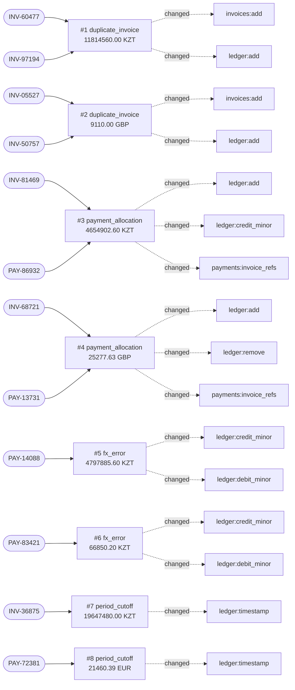

# Episode ep-2aa0aede9dd5 (evaluator-only)

Period 2026-03-01T00:00:00-07:00 .. 2026-04-01T00:00:00-07:00 (end exclusive), company timezone UTC-07:00, base KZT, currencies KZT, GBP, EUR. Records: {'ledger_rows': 309, 'invoices': 83, 'payments': 52, 'documents': 135, 'fx_rates': 528}.

## 8 hidden errors

| # | type | affected | amount | how to see it |
|---|---|---|---|---|
| 1 | duplicate_invoice | INV-60477, INV-97194 | 11814560.00 KZT | Same entity, same po_ref, same line items (in a different order) under a second invoice number. |
| 2 | duplicate_invoice | INV-05527, INV-50757 | 9110.00 GBP | Same entity, same po_ref, same line items (in a different order) under a second invoice number. |
| 3 | payment_allocation (partial allocation) | INV-81469, PAY-86932 | 4654902.60 KZT | The payment memo names an invoice, but invoice_refs allocate less than the amount (or are null); the rest sits in UNAPPLIED. |
| 4 | payment_allocation (missing allocation) | INV-68721, PAY-13731 | 25277.63 GBP | The payment memo names an invoice, but invoice_refs allocate less than the amount (or are null); the rest sits in UNAPPLIED. |
| 5 | fx_error (two digits of the rate swapped when keyed in) | PAY-14088 | 4797885.60 KZT | Re-convert the ALLOCATED amount at the fx row of the payment's LOCAL date (company timezone) and compare with the AR credit. |
| 6 | fx_error (rate of the previous day) | PAY-83421 | 66850.20 KZT | Re-convert the ALLOCATED amount at the fx row of the payment's LOCAL date (company timezone) and compare with the AR credit. |
| 7 | period_cutoff | INV-36875 | 19647480.00 KZT | Compare the period side (before / in / after, company timezone) of the document timestamp and of its ledger rows. |
| 8 | period_cutoff | PAY-72381 | 21460.39 EUR | Compare the period side (before / in / after, company timezone) of the document timestamp and of its ledger rows. |

## Causal graph

## Legitimate look-alikes in this company (not errors)

- same amounts for the same customer with a different po_ref (legitimate repeat orders)
- monthly subscriptions with identical lines
- instalments and multi-invoice payments
- refunds (negative amounts)
- advance payments on account: legitimate UNAPPLIED cash, memo names no invoice
- documents near the period boundary rendered in a foreign UTC offset (calendar-date strings mislead)
- correct cross-currency receipts
