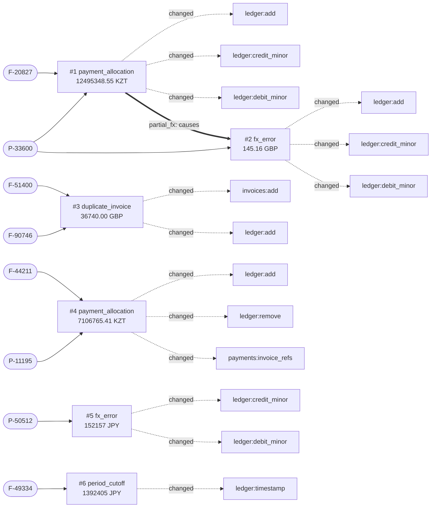

# Episode ep-312d1169b9de (evaluator-only)

Period 2026-04-01T00:00:00+05:00 .. 2026-07-01T00:00:00+05:00 (end exclusive), company timezone UTC+05:00, base JPY, currencies JPY, GBP, KZT. Records: {'ledger_rows': 367, 'invoices': 86, 'payments': 61, 'documents': 147, 'fx_rates': 888}.

## 6 hidden errors

| # | type | affected | amount | how to see it |
|---|---|---|---|---|
| 1 | payment_allocation (partial allocation) | F-20827, P-33600 | 12495348.55 KZT | The payment memo names an invoice, but invoice_refs allocate less than the amount (or are null); the rest sits in UNAPPLIED. |
| 2 | fx_error (rate taken for the UTC date instead of the local date) | P-33600 | 145.16 GBP | Re-convert the ALLOCATED amount at the fx row of the payment's LOCAL date (company timezone) and compare with the AR credit. |
| 3 | duplicate_invoice | F-51400, F-90746 | 36740.00 GBP | Same entity, same po_ref, same line items (in a different order) under a second invoice number. |
| 4 | payment_allocation (missing allocation) | F-44211, P-11195 | 7106765.41 KZT | The payment memo names an invoice, but invoice_refs allocate less than the amount (or are null); the rest sits in UNAPPLIED. |
| 5 | fx_error (two digits of the rate swapped when keyed in) | P-50512 | 152157 JPY | Re-convert the ALLOCATED amount at the fx row of the payment's LOCAL date (company timezone) and compare with the AR credit. |
| 6 | period_cutoff | F-49334 | 1392405 JPY | Compare the period side (before / in / after, company timezone) of the document timestamp and of its ledger rows. |

## Causal graph

## Interacting errors

- **partial_fx**: FX conversion applied to the allocated part; wrong rate date taken from the UTC date of the payment.

## Legitimate look-alikes in this company (not errors)

- same amounts for the same customer with a different po_ref (legitimate repeat orders)
- monthly subscriptions with identical lines
- instalments and multi-invoice payments
- refunds (negative amounts)
- advance payments on account: legitimate UNAPPLIED cash, memo names no invoice
- documents near the period boundary rendered in a foreign UTC offset (calendar-date strings mislead)
- correct cross-currency receipts
