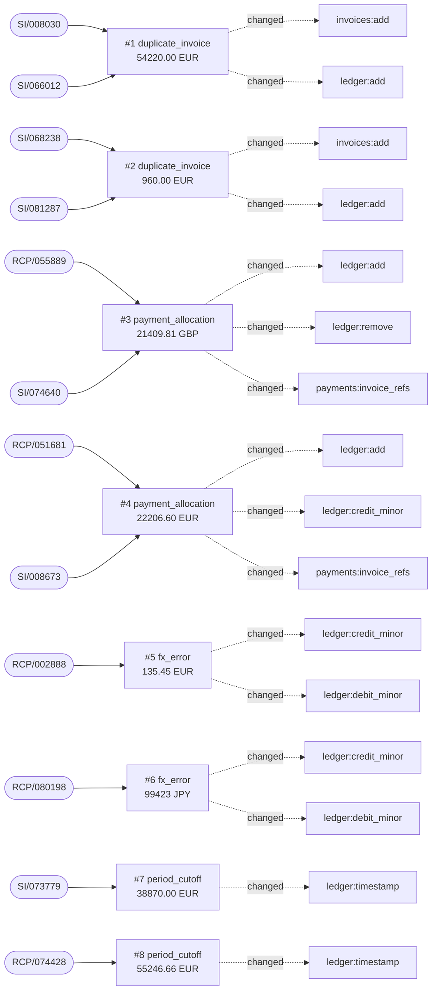

# Episode ep-618490c58e37 (evaluator-only)

Period 2026-06-01T00:00:00-05:00 .. 2026-08-01T00:00:00-05:00 (end exclusive), company timezone UTC-05:00, base EUR, currencies EUR, GBP, JPY. Records: {'ledger_rows': 351, 'invoices': 86, 'payments': 65, 'documents': 151, 'fx_rates': 708}.

## 8 hidden errors

| # | type | affected | amount | how to see it |
|---|---|---|---|---|
| 1 | duplicate_invoice | SI/008030, SI/066012 | 54220.00 EUR | Same entity, same po_ref, same line items (in a different order) under a second invoice number. |
| 2 | duplicate_invoice | SI/068238, SI/081287 | 960.00 EUR | Same entity, same po_ref, same line items (in a different order) under a second invoice number. |
| 3 | payment_allocation (missing allocation) | RCP/055889, SI/074640 | 21409.81 GBP | The payment memo names an invoice, but invoice_refs allocate less than the amount (or are null); the rest sits in UNAPPLIED. |
| 4 | payment_allocation (partial allocation) | RCP/051681, SI/008673 | 22206.60 EUR | The payment memo names an invoice, but invoice_refs allocate less than the amount (or are null); the rest sits in UNAPPLIED. |
| 5 | fx_error (rate of the invoice date) | RCP/002888 | 135.45 EUR | Re-convert the ALLOCATED amount at the fx row of the payment's LOCAL date (company timezone) and compare with the AR credit. |
| 6 | fx_error (rate of the previous day) | RCP/080198 | 99423 JPY | Re-convert the ALLOCATED amount at the fx row of the payment's LOCAL date (company timezone) and compare with the AR credit. |
| 7 | period_cutoff | SI/073779 | 38870.00 EUR | Compare the period side (before / in / after, company timezone) of the document timestamp and of its ledger rows. |
| 8 | period_cutoff | RCP/074428 | 55246.66 EUR | Compare the period side (before / in / after, company timezone) of the document timestamp and of its ledger rows. |

## Causal graph

## Legitimate look-alikes in this company (not errors)

- same amounts for the same customer with a different po_ref (legitimate repeat orders)
- monthly subscriptions with identical lines
- instalments and multi-invoice payments
- refunds (negative amounts)
- advance payments on account: legitimate UNAPPLIED cash, memo names no invoice
- documents near the period boundary rendered in a foreign UTC offset (calendar-date strings mislead)
- correct cross-currency receipts
