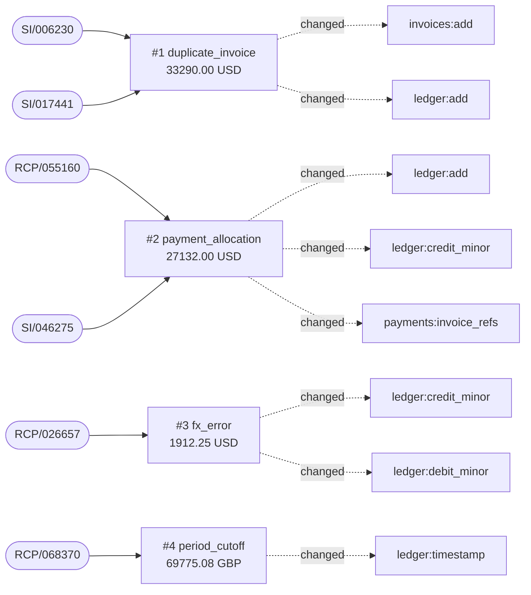

# Episode ep-6d6132bcd7eb (evaluator-only)

Period 2026-02-01T00:00:00+08:00 .. 2026-04-01T00:00:00+08:00 (end exclusive), company timezone UTC+08:00, base USD, currencies USD, GBP, JPY. Records: {'ledger_rows': 357, 'invoices': 98, 'payments': 59, 'documents': 157, 'fx_rates': 696}.

## 4 hidden errors

| # | type | affected | amount | how to see it |
|---|---|---|---|---|
| 1 | duplicate_invoice | SI/006230, SI/017441 | 33290.00 USD | Same entity, same po_ref, same line items (in a different order) under a second invoice number. |
| 2 | payment_allocation (partial allocation) | RCP/055160, SI/046275 | 27132.00 USD | The payment memo names an invoice, but invoice_refs allocate less than the amount (or are null); the rest sits in UNAPPLIED. |
| 3 | fx_error (rate of the invoice date) | RCP/026657 | 1912.25 USD | Re-convert the ALLOCATED amount at the fx row of the payment's LOCAL date (company timezone) and compare with the AR credit. |
| 4 | period_cutoff | RCP/068370 | 69775.08 GBP | Compare the period side (before / in / after, company timezone) of the document timestamp and of its ledger rows. |

## Causal graph

## Legitimate look-alikes in this company (not errors)

- same amounts for the same customer with a different po_ref (legitimate repeat orders)
- monthly subscriptions with identical lines
- instalments and multi-invoice payments
- refunds (negative amounts)
- advance payments on account: legitimate UNAPPLIED cash, memo names no invoice
- documents near the period boundary rendered in a foreign UTC offset (calendar-date strings mislead)
- correct cross-currency receipts
