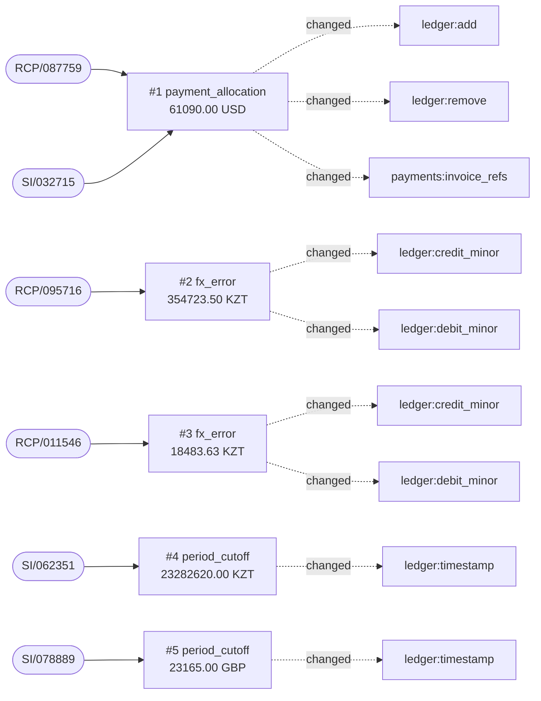

# Episode ep-91f536cf608a (evaluator-only)

Period 2026-01-01T00:00:00+09:00 .. 2026-02-01T00:00:00+09:00 (end exclusive), company timezone UTC+09:00, base USD, currencies USD, KZT, GBP. Records: {'ledger_rows': 298, 'invoices': 82, 'payments': 50, 'documents': 132, 'fx_rates': 528}.

## 5 hidden errors

| # | type | affected | amount | how to see it |
|---|---|---|---|---|
| 1 | payment_allocation (missing allocation) | RCP/087759, SI/032715 | 61090.00 USD | The payment memo names an invoice, but invoice_refs allocate less than the amount (or are null); the rest sits in UNAPPLIED. |
| 2 | fx_error (rate of the previous day) | RCP/095716 | 354723.50 KZT | Re-convert the ALLOCATED amount at the fx row of the payment's LOCAL date (company timezone) and compare with the AR credit. |
| 3 | fx_error (rate of the previous day) | RCP/011546 | 18483.63 KZT | Re-convert the ALLOCATED amount at the fx row of the payment's LOCAL date (company timezone) and compare with the AR credit. |
| 4 | period_cutoff | SI/062351 | 23282620.00 KZT | Compare the period side (before / in / after, company timezone) of the document timestamp and of its ledger rows. |
| 5 | period_cutoff | SI/078889 | 23165.00 GBP | Compare the period side (before / in / after, company timezone) of the document timestamp and of its ledger rows. |

## Causal graph

## Legitimate look-alikes in this company (not errors)

- same amounts for the same customer with a different po_ref (legitimate repeat orders)
- monthly subscriptions with identical lines
- instalments and multi-invoice payments
- refunds (negative amounts)
- advance payments on account: legitimate UNAPPLIED cash, memo names no invoice
- documents near the period boundary rendered in a foreign UTC offset (calendar-date strings mislead)
- correct cross-currency receipts
