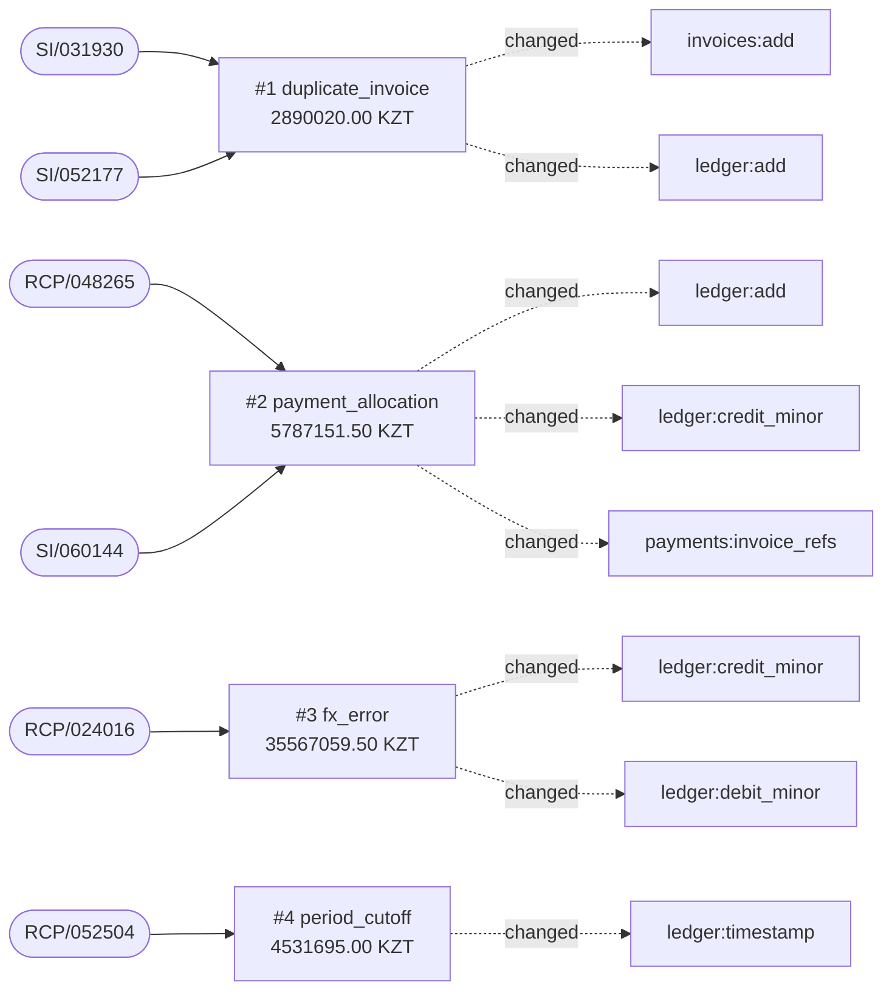

# Episode ep-9323875db342 (evaluator-only)

Period 2026-02-01T00:00:00+08:00 .. 2026-03-01T00:00:00+08:00 (end exclusive), company timezone UTC+08:00, base KZT, currencies KZT, USD, EUR. Records: {'ledger_rows': 387, 'invoices': 99, 'payments': 70, 'documents': 169, 'fx_rates': 510}.

## 4 hidden errors

| # | type | affected | amount | how to see it |
|---|---|---|---|---|
| 1 | duplicate_invoice | SI/031930, SI/052177 | 2890020.00 KZT | Same entity, same po_ref, same line items (in a different order) under a second invoice number. |
| 2 | payment_allocation (partial allocation) | RCP/048265, SI/060144 | 5787151.50 KZT | The payment memo names an invoice, but invoice_refs allocate less than the amount (or are null); the rest sits in UNAPPLIED. |
| 3 | fx_error (two digits of the rate swapped when keyed in) | RCP/024016 | 35567059.50 KZT | Re-convert the ALLOCATED amount at the fx row of the payment's LOCAL date (company timezone) and compare with the AR credit. |
| 4 | period_cutoff | RCP/052504 | 4531695.00 KZT | Compare the period side (before / in / after, company timezone) of the document timestamp and of its ledger rows. |

## Causal graph

## Legitimate look-alikes in this company (not errors)

- same amounts for the same customer with a different po_ref (legitimate repeat orders)
- monthly subscriptions with identical lines
- instalments and multi-invoice payments
- refunds (negative amounts)
- advance payments on account: legitimate UNAPPLIED cash, memo names no invoice
- documents near the period boundary rendered in a foreign UTC offset (calendar-date strings mislead)
- correct cross-currency receipts
