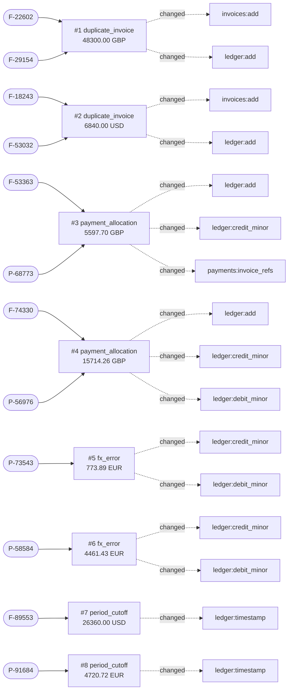

# Episode ep-9bfddc513e24 (evaluator-only)

Period 2026-07-01T00:00:00+02:00 .. 2026-08-01T00:00:00+02:00 (end exclusive), company timezone UTC+02:00, base GBP, currencies GBP, USD, EUR. Records: {'ledger_rows': 346, 'invoices': 86, 'payments': 63, 'documents': 149, 'fx_rates': 528}.

## 8 hidden errors

| # | type | affected | amount | how to see it |
|---|---|---|---|---|
| 1 | duplicate_invoice | F-22602, F-29154 | 48300.00 GBP | Same entity, same po_ref, same line items (in a different order) under a second invoice number. |
| 2 | duplicate_invoice | F-18243, F-53032 | 6840.00 USD | Same entity, same po_ref, same line items (in a different order) under a second invoice number. |
| 3 | payment_allocation (partial allocation) | F-53363, P-68773 | 5597.70 GBP | The payment memo names an invoice, but invoice_refs allocate less than the amount (or are null); the rest sits in UNAPPLIED. |
| 4 | payment_allocation (partial allocation) | F-74330, P-56976 | 15714.26 GBP | The payment memo names an invoice, but invoice_refs allocate less than the amount (or are null); the rest sits in UNAPPLIED. |
| 5 | fx_error (rate of the invoice date) | P-73543 | 773.89 EUR | Re-convert the ALLOCATED amount at the fx row of the payment's LOCAL date (company timezone) and compare with the AR credit. |
| 6 | fx_error (two digits of the rate swapped when keyed in) | P-58584 | 4461.43 EUR | Re-convert the ALLOCATED amount at the fx row of the payment's LOCAL date (company timezone) and compare with the AR credit. |
| 7 | period_cutoff | F-89553 | 26360.00 USD | Compare the period side (before / in / after, company timezone) of the document timestamp and of its ledger rows. |
| 8 | period_cutoff | P-91684 | 4720.72 EUR | Compare the period side (before / in / after, company timezone) of the document timestamp and of its ledger rows. |

## Causal graph

## Legitimate look-alikes in this company (not errors)

- same amounts for the same customer with a different po_ref (legitimate repeat orders)
- monthly subscriptions with identical lines
- instalments and multi-invoice payments
- refunds (negative amounts)
- advance payments on account: legitimate UNAPPLIED cash, memo names no invoice
- documents near the period boundary rendered in a foreign UTC offset (calendar-date strings mislead)
- correct cross-currency receipts
