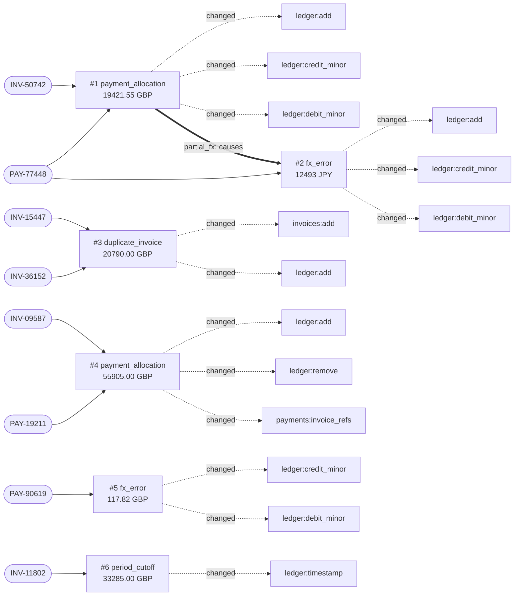

# Episode ep-caa12dc98a26 (evaluator-only)

Period 2026-05-01T00:00:00-07:00 .. 2026-06-01T00:00:00-07:00 (end exclusive), company timezone UTC-07:00, base GBP, currencies GBP, USD, JPY. Records: {'ledger_rows': 299, 'invoices': 81, 'payments': 53, 'documents': 134, 'fx_rates': 528}.

## 6 hidden errors

| # | type | affected | amount | how to see it |
|---|---|---|---|---|
| 1 | payment_allocation (partial allocation) | INV-50742, PAY-77448 | 19421.55 GBP | The payment memo names an invoice, but invoice_refs allocate less than the amount (or are null); the rest sits in UNAPPLIED. |
| 2 | fx_error (rate taken for the UTC date instead of the local date) | PAY-77448 | 12493 JPY | Re-convert the ALLOCATED amount at the fx row of the payment's LOCAL date (company timezone) and compare with the AR credit. |
| 3 | duplicate_invoice | INV-15447, INV-36152 | 20790.00 GBP | Same entity, same po_ref, same line items (in a different order) under a second invoice number. |
| 4 | payment_allocation (missing allocation) | INV-09587, PAY-19211 | 55905.00 GBP | The payment memo names an invoice, but invoice_refs allocate less than the amount (or are null); the rest sits in UNAPPLIED. |
| 5 | fx_error (rate taken for the UTC date instead of the local date) | PAY-90619 | 117.82 GBP | Re-convert the ALLOCATED amount at the fx row of the payment's LOCAL date (company timezone) and compare with the AR credit. |
| 6 | period_cutoff | INV-11802 | 33285.00 GBP | Compare the period side (before / in / after, company timezone) of the document timestamp and of its ledger rows. |

## Causal graph

## Interacting errors

- **partial_fx**: FX conversion applied to the allocated part; wrong rate date taken from the UTC date of the payment.

## Legitimate look-alikes in this company (not errors)

- same amounts for the same customer with a different po_ref (legitimate repeat orders)
- monthly subscriptions with identical lines
- instalments and multi-invoice payments
- refunds (negative amounts)
- advance payments on account: legitimate UNAPPLIED cash, memo names no invoice
- documents near the period boundary rendered in a foreign UTC offset (calendar-date strings mislead)
- correct cross-currency receipts
