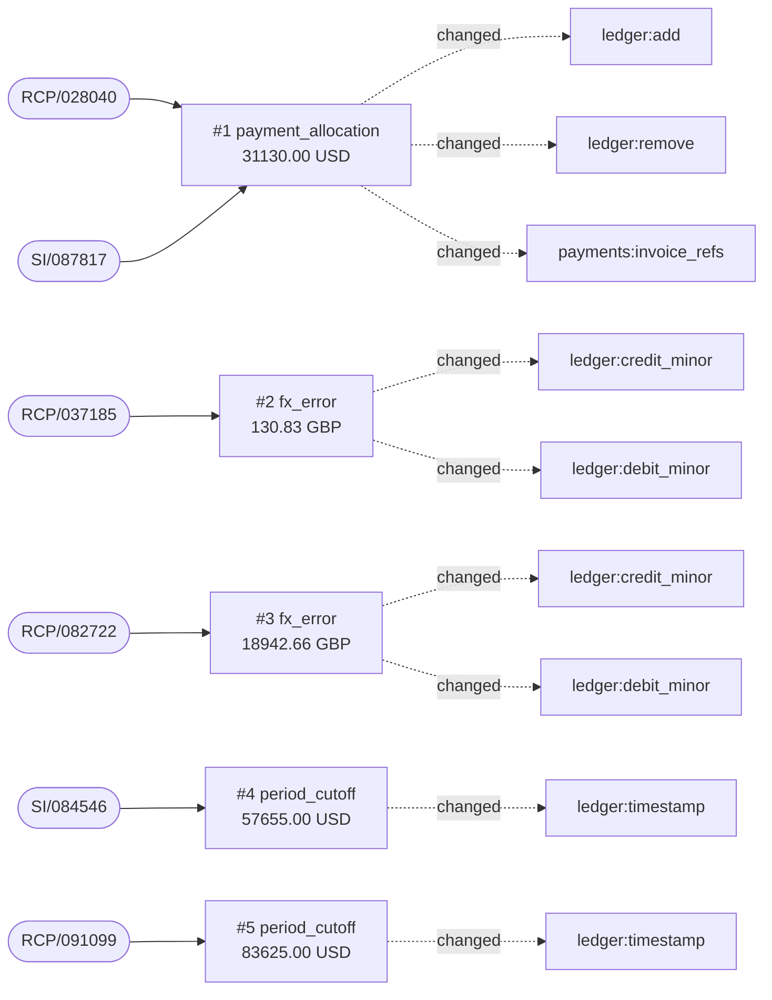

# Episode ep-d4cfc8e12d24 (evaluator-only)

Period 2026-01-01T00:00:00+08:00 .. 2026-04-01T00:00:00+08:00 (end exclusive), company timezone UTC+08:00, base USD, currencies USD, KZT, GBP. Records: {'ledger_rows': 336, 'invoices': 88, 'payments': 64, 'documents': 152, 'fx_rates': 882}.

## 5 hidden errors

| # | type | affected | amount | how to see it |
|---|---|---|---|---|
| 1 | payment_allocation (missing allocation) | RCP/028040, SI/087817 | 31130.00 USD | The payment memo names an invoice, but invoice_refs allocate less than the amount (or are null); the rest sits in UNAPPLIED. |
| 2 | fx_error (rate of the invoice date) | RCP/037185 | 130.83 GBP | Re-convert the ALLOCATED amount at the fx row of the payment's LOCAL date (company timezone) and compare with the AR credit. |
| 3 | fx_error (two digits of the rate swapped when keyed in) | RCP/082722 | 18942.66 GBP | Re-convert the ALLOCATED amount at the fx row of the payment's LOCAL date (company timezone) and compare with the AR credit. |
| 4 | period_cutoff | SI/084546 | 57655.00 USD | Compare the period side (before / in / after, company timezone) of the document timestamp and of its ledger rows. |
| 5 | period_cutoff | RCP/091099 | 83625.00 USD | Compare the period side (before / in / after, company timezone) of the document timestamp and of its ledger rows. |

## Causal graph

## Legitimate look-alikes in this company (not errors)

- same amounts for the same customer with a different po_ref (legitimate repeat orders)
- monthly subscriptions with identical lines
- instalments and multi-invoice payments
- refunds (negative amounts)
- advance payments on account: legitimate UNAPPLIED cash, memo names no invoice
- documents near the period boundary rendered in a foreign UTC offset (calendar-date strings mislead)
- correct cross-currency receipts
