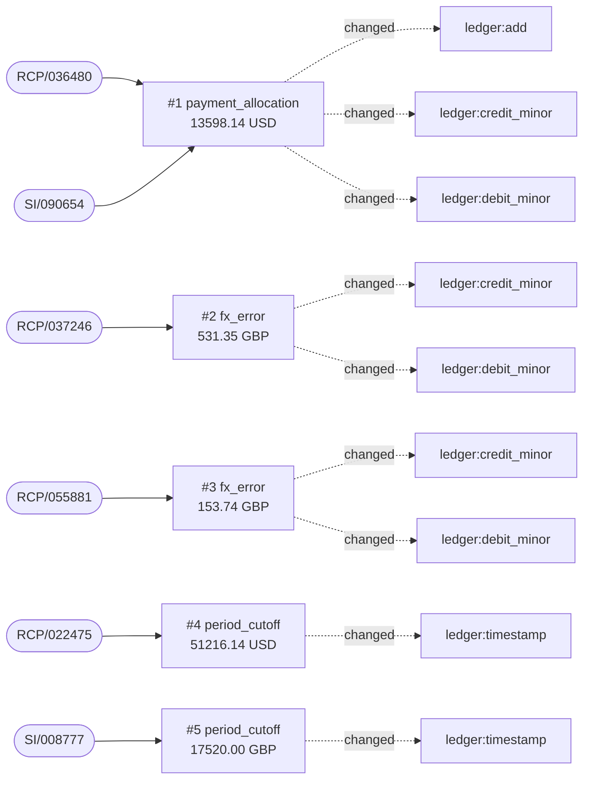

# Episode ep-dc78573232db (evaluator-only)

Period 2026-04-01T00:00:00-05:00 .. 2026-07-01T00:00:00-05:00 (end exclusive), company timezone UTC-05:00, base GBP, currencies GBP, USD, KZT. Records: {'ledger_rows': 331, 'invoices': 86, 'payments': 61, 'documents': 147, 'fx_rates': 888}.

## 5 hidden errors

| # | type | affected | amount | how to see it |
|---|---|---|---|---|
| 1 | payment_allocation (partial allocation) | RCP/036480, SI/090654 | 13598.14 USD | The payment memo names an invoice, but invoice_refs allocate less than the amount (or are null); the rest sits in UNAPPLIED. |
| 2 | fx_error (rate of the invoice date) | RCP/037246 | 531.35 GBP | Re-convert the ALLOCATED amount at the fx row of the payment's LOCAL date (company timezone) and compare with the AR credit. |
| 3 | fx_error (rate of the previous day) | RCP/055881 | 153.74 GBP | Re-convert the ALLOCATED amount at the fx row of the payment's LOCAL date (company timezone) and compare with the AR credit. |
| 4 | period_cutoff | RCP/022475 | 51216.14 USD | Compare the period side (before / in / after, company timezone) of the document timestamp and of its ledger rows. |
| 5 | period_cutoff | SI/008777 | 17520.00 GBP | Compare the period side (before / in / after, company timezone) of the document timestamp and of its ledger rows. |

## Causal graph

## Legitimate look-alikes in this company (not errors)

- same amounts for the same customer with a different po_ref (legitimate repeat orders)
- monthly subscriptions with identical lines
- instalments and multi-invoice payments
- refunds (negative amounts)
- advance payments on account: legitimate UNAPPLIED cash, memo names no invoice
- documents near the period boundary rendered in a foreign UTC offset (calendar-date strings mislead)
- correct cross-currency receipts
