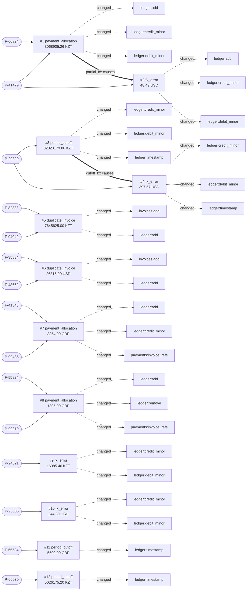

# Episode ep-e81c4e5abef8 (evaluator-only)

Period 2026-06-01T00:00:00-07:00 .. 2026-08-01T00:00:00-07:00 (end exclusive), company timezone UTC-07:00, base USD, currencies USD, GBP, KZT. Records: {'ledger_rows': 354, 'invoices': 91, 'payments': 63, 'documents': 154, 'fx_rates': 708}.

## 12 hidden errors

| # | type | affected | amount | how to see it |
|---|---|---|---|---|
| 1 | payment_allocation (partial allocation) | F-66824, P-41479 | 3068905.26 KZT | The payment memo names an invoice, but invoice_refs allocate less than the amount (or are null); the rest sits in UNAPPLIED. |
| 2 | fx_error (rate taken for the UTC date instead of the local date) | P-41479 | 48.49 USD | Re-convert the ALLOCATED amount at the fx row of the payment's LOCAL date (company timezone) and compare with the AR credit. |
| 3 | period_cutoff | P-29829 | 32023179.86 KZT | Compare the period side (before / in / after, company timezone) of the document timestamp and of its ledger rows. |
| 4 | fx_error (rate of the (wrong) posting date) | P-29829 | 397.57 USD | Re-convert the ALLOCATED amount at the fx row of the payment's LOCAL date (company timezone) and compare with the AR credit. |
| 5 | duplicate_invoice | F-82838, F-94049 | 7645625.00 KZT | Same entity, same po_ref, same line items (in a different order) under a second invoice number. |
| 6 | duplicate_invoice | F-35834, F-48662 | 26815.00 USD | Same entity, same po_ref, same line items (in a different order) under a second invoice number. |
| 7 | payment_allocation (partial allocation) | F-41348, P-09486 | 3354.00 GBP | The payment memo names an invoice, but invoice_refs allocate less than the amount (or are null); the rest sits in UNAPPLIED. |
| 8 | payment_allocation (missing allocation) | F-55924, P-99919 | 1305.00 GBP | The payment memo names an invoice, but invoice_refs allocate less than the amount (or are null); the rest sits in UNAPPLIED. |
| 9 | fx_error (rate of the invoice date) | P-24621 | 16985.46 KZT | Re-convert the ALLOCATED amount at the fx row of the payment's LOCAL date (company timezone) and compare with the AR credit. |
| 10 | fx_error (rate taken for the UTC date instead of the local date) | P-25085 | 244.30 USD | Re-convert the ALLOCATED amount at the fx row of the payment's LOCAL date (company timezone) and compare with the AR credit. |
| 11 | period_cutoff | F-65534 | 5500.00 GBP | Compare the period side (before / in / after, company timezone) of the document timestamp and of its ledger rows. |
| 12 | period_cutoff | P-66030 | 5026175.20 KZT | Compare the period side (before / in / after, company timezone) of the document timestamp and of its ledger rows. |

## Causal graph

## Interacting errors

- **partial_fx**: FX conversion applied to the allocated part; wrong rate date taken from the UTC date of the payment.
- **cutoff_fx**: misposted entry converted at the rate of its (wrong) posting date.

## Legitimate look-alikes in this company (not errors)

- same amounts for the same customer with a different po_ref (legitimate repeat orders)
- monthly subscriptions with identical lines
- instalments and multi-invoice payments
- refunds (negative amounts)
- advance payments on account: legitimate UNAPPLIED cash, memo names no invoice
- documents near the period boundary rendered in a foreign UTC offset (calendar-date strings mislead)
- correct cross-currency receipts
