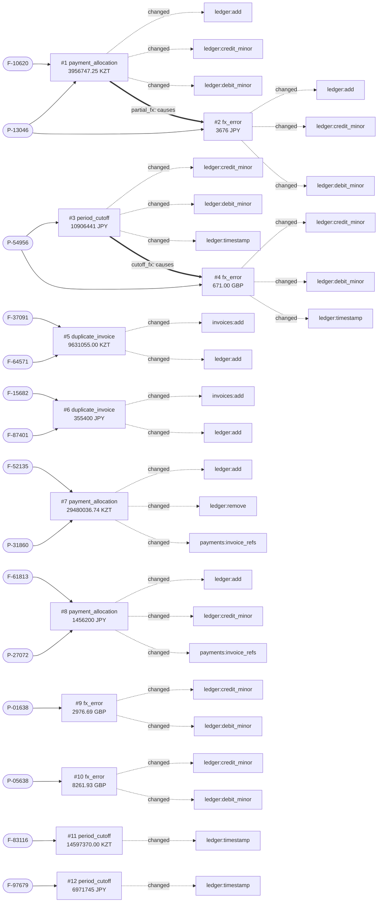

# Episode ep-e88e8417c8fd (evaluator-only)

Period 2026-02-01T00:00:00+01:00 .. 2026-03-01T00:00:00+01:00 (end exclusive), company timezone UTC+01:00, base JPY, currencies JPY, GBP, KZT. Records: {'ledger_rows': 324, 'invoices': 90, 'payments': 53, 'documents': 143, 'fx_rates': 510}.

## 12 hidden errors

| # | type | affected | amount | how to see it |
|---|---|---|---|---|
| 1 | payment_allocation (partial allocation) | F-10620, P-13046 | 3956747.25 KZT | The payment memo names an invoice, but invoice_refs allocate less than the amount (or are null); the rest sits in UNAPPLIED. |
| 2 | fx_error (rate taken for the UTC date instead of the local date) | P-13046 | 3676 JPY | Re-convert the ALLOCATED amount at the fx row of the payment's LOCAL date (company timezone) and compare with the AR credit. |
| 3 | period_cutoff | P-54956 | 10906441 JPY | Compare the period side (before / in / after, company timezone) of the document timestamp and of its ledger rows. |
| 4 | fx_error (rate of the (wrong) posting date) | P-54956 | 671.00 GBP | Re-convert the ALLOCATED amount at the fx row of the payment's LOCAL date (company timezone) and compare with the AR credit. |
| 5 | duplicate_invoice | F-37091, F-64571 | 9631055.00 KZT | Same entity, same po_ref, same line items (in a different order) under a second invoice number. |
| 6 | duplicate_invoice | F-15682, F-87401 | 355400 JPY | Same entity, same po_ref, same line items (in a different order) under a second invoice number. |
| 7 | payment_allocation (missing allocation) | F-52135, P-31860 | 29480036.74 KZT | The payment memo names an invoice, but invoice_refs allocate less than the amount (or are null); the rest sits in UNAPPLIED. |
| 8 | payment_allocation (partial allocation) | F-61813, P-27072 | 1456200 JPY | The payment memo names an invoice, but invoice_refs allocate less than the amount (or are null); the rest sits in UNAPPLIED. |
| 9 | fx_error (rate of the invoice date) | P-01638 | 2976.69 GBP | Re-convert the ALLOCATED amount at the fx row of the payment's LOCAL date (company timezone) and compare with the AR credit. |
| 10 | fx_error (two digits of the rate swapped when keyed in) | P-05638 | 8261.93 GBP | Re-convert the ALLOCATED amount at the fx row of the payment's LOCAL date (company timezone) and compare with the AR credit. |
| 11 | period_cutoff | F-83116 | 14597370.00 KZT | Compare the period side (before / in / after, company timezone) of the document timestamp and of its ledger rows. |
| 12 | period_cutoff | F-97679 | 6971745 JPY | Compare the period side (before / in / after, company timezone) of the document timestamp and of its ledger rows. |

## Causal graph

## Interacting errors

- **partial_fx**: FX conversion applied to the allocated part; wrong rate date taken from the UTC date of the payment.
- **cutoff_fx**: misposted entry converted at the rate of its (wrong) posting date.

## Legitimate look-alikes in this company (not errors)

- same amounts for the same customer with a different po_ref (legitimate repeat orders)
- monthly subscriptions with identical lines
- instalments and multi-invoice payments
- refunds (negative amounts)
- advance payments on account: legitimate UNAPPLIED cash, memo names no invoice
- documents near the period boundary rendered in a foreign UTC offset (calendar-date strings mislead)
- correct cross-currency receipts
