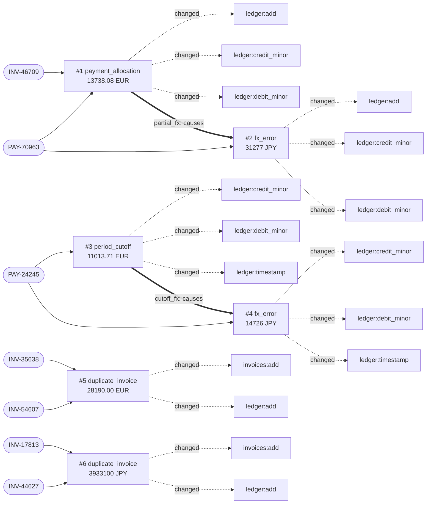

# Episode ep-f7edd7915e65 (evaluator-only)

Period 2026-02-01T00:00:00+08:00 .. 2026-04-01T00:00:00+08:00 (end exclusive), company timezone UTC+08:00, base JPY, currencies JPY, EUR, GBP. Records: {'ledger_rows': 339, 'invoices': 83, 'payments': 61, 'documents': 144, 'fx_rates': 696}.

## 6 hidden errors

| # | type | affected | amount | how to see it |
|---|---|---|---|---|
| 1 | payment_allocation (partial allocation) | INV-46709, PAY-70963 | 13738.08 EUR | The payment memo names an invoice, but invoice_refs allocate less than the amount (or are null); the rest sits in UNAPPLIED. |
| 2 | fx_error (rate taken for the UTC date instead of the local date) | PAY-70963 | 31277 JPY | Re-convert the ALLOCATED amount at the fx row of the payment's LOCAL date (company timezone) and compare with the AR credit. |
| 3 | period_cutoff | PAY-24245 | 11013.71 EUR | Compare the period side (before / in / after, company timezone) of the document timestamp and of its ledger rows. |
| 4 | fx_error (rate of the (wrong) posting date) | PAY-24245 | 14726 JPY | Re-convert the ALLOCATED amount at the fx row of the payment's LOCAL date (company timezone) and compare with the AR credit. |
| 5 | duplicate_invoice | INV-35638, INV-54607 | 28190.00 EUR | Same entity, same po_ref, same line items (in a different order) under a second invoice number. |
| 6 | duplicate_invoice | INV-17813, INV-44627 | 3933100 JPY | Same entity, same po_ref, same line items (in a different order) under a second invoice number. |

## Causal graph

## Interacting errors

- **partial_fx**: FX conversion applied to the allocated part; wrong rate date taken from the UTC date of the payment.
- **cutoff_fx**: misposted entry converted at the rate of its (wrong) posting date.

## Legitimate look-alikes in this company (not errors)

- same amounts for the same customer with a different po_ref (legitimate repeat orders)
- monthly subscriptions with identical lines
- instalments and multi-invoice payments
- refunds (negative amounts)
- advance payments on account: legitimate UNAPPLIED cash, memo names no invoice
- documents near the period boundary rendered in a foreign UTC offset (calendar-date strings mislead)
- correct cross-currency receipts
