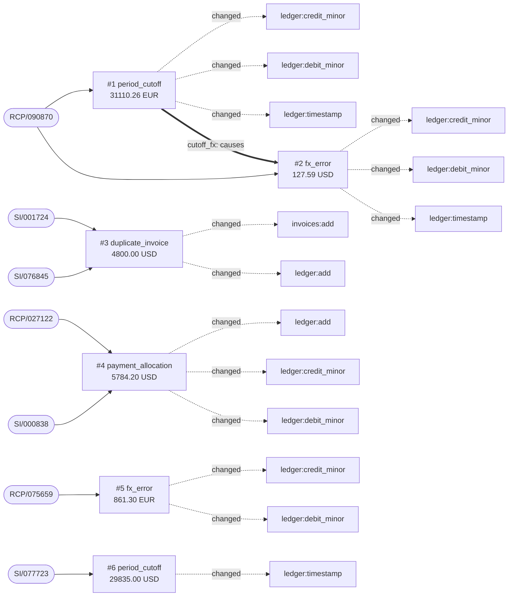

# Episode ep-f9f97e238c4c (evaluator-only)

Period 2026-05-01T00:00:00+00:00 .. 2026-06-01T00:00:00+00:00 (end exclusive), company timezone UTC+00:00, base USD, currencies USD, EUR, GBP. Records: {'ledger_rows': 323, 'invoices': 83, 'payments': 56, 'documents': 139, 'fx_rates': 528}.

## 6 hidden errors

| # | type | affected | amount | how to see it |
|---|---|---|---|---|
| 1 | period_cutoff | RCP/090870 | 31110.26 EUR | Compare the period side (before / in / after, company timezone) of the document timestamp and of its ledger rows. |
| 2 | fx_error (rate of the (wrong) posting date) | RCP/090870 | 127.59 USD | Re-convert the ALLOCATED amount at the fx row of the payment's LOCAL date (company timezone) and compare with the AR credit. |
| 3 | duplicate_invoice | SI/001724, SI/076845 | 4800.00 USD | Same entity, same po_ref, same line items (in a different order) under a second invoice number. |
| 4 | payment_allocation (partial allocation) | RCP/027122, SI/000838 | 5784.20 USD | The payment memo names an invoice, but invoice_refs allocate less than the amount (or are null); the rest sits in UNAPPLIED. |
| 5 | fx_error (two digits of the rate swapped when keyed in) | RCP/075659 | 861.30 EUR | Re-convert the ALLOCATED amount at the fx row of the payment's LOCAL date (company timezone) and compare with the AR credit. |
| 6 | period_cutoff | SI/077723 | 29835.00 USD | Compare the period side (before / in / after, company timezone) of the document timestamp and of its ledger rows. |

## Causal graph

## Interacting errors

- **cutoff_fx**: misposted entry converted at the rate of its (wrong) posting date.

## Legitimate look-alikes in this company (not errors)

- same amounts for the same customer with a different po_ref (legitimate repeat orders)
- monthly subscriptions with identical lines
- instalments and multi-invoice payments
- refunds (negative amounts)
- advance payments on account: legitimate UNAPPLIED cash, memo names no invoice
- documents near the period boundary rendered in a foreign UTC offset (calendar-date strings mislead)
- correct cross-currency receipts
