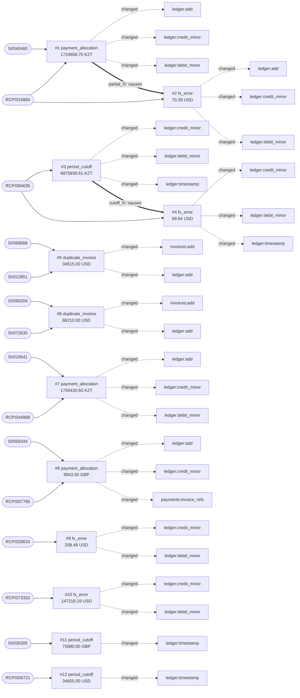

# Episode ep-fc37abbc580a (evaluator-only)

Period 2026-05-01T00:00:00+08:00 .. 2026-08-01T00:00:00+08:00 (end exclusive), company timezone UTC+08:00, base GBP, currencies GBP, USD, KZT. Records: {'ledger_rows': 351, 'invoices': 91, 'payments': 65, 'documents': 156, 'fx_rates': 894}.

## 12 hidden errors

| # | type | affected | amount | how to see it |
|---|---|---|---|---|
| 1 | payment_allocation (partial allocation) | RCP/016884, SI/040460 | 1724658.70 KZT | The payment memo names an invoice, but invoice_refs allocate less than the amount (or are null); the rest sits in UNAPPLIED. |
| 2 | fx_error (rate taken for the UTC date instead of the local date) | RCP/016884 | 70.39 USD | Re-convert the ALLOCATED amount at the fx row of the payment's LOCAL date (company timezone) and compare with the AR credit. |
| 3 | period_cutoff | RCP/084635 | 6875939.61 KZT | Compare the period side (before / in / after, company timezone) of the document timestamp and of its ledger rows. |
| 4 | fx_error (rate of the (wrong) posting date) | RCP/084635 | 69.64 USD | Re-convert the ALLOCATED amount at the fx row of the payment's LOCAL date (company timezone) and compare with the AR credit. |
| 5 | duplicate_invoice | SI/012851, SI/069068 | 34515.00 USD | Same entity, same po_ref, same line items (in a different order) under a second invoice number. |
| 6 | duplicate_invoice | SI/072635, SI/090204 | 86210.00 USD | Same entity, same po_ref, same line items (in a different order) under a second invoice number. |
| 7 | payment_allocation (partial allocation) | RCP/044968, SI/019541 | 1759430.60 KZT | The payment memo names an invoice, but invoice_refs allocate less than the amount (or are null); the rest sits in UNAPPLIED. |
| 8 | payment_allocation (partial allocation) | RCP/007785, SI/056344 | 9943.50 GBP | The payment memo names an invoice, but invoice_refs allocate less than the amount (or are null); the rest sits in UNAPPLIED. |
| 9 | fx_error (rate of the invoice date) | RCP/028633 | 208.48 USD | Re-convert the ALLOCATED amount at the fx row of the payment's LOCAL date (company timezone) and compare with the AR credit. |
| 10 | fx_error (two digits of the rate swapped when keyed in) | RCP/073332 | 147218.19 USD | Re-convert the ALLOCATED amount at the fx row of the payment's LOCAL date (company timezone) and compare with the AR credit. |
| 11 | period_cutoff | SI/035305 | 75880.00 GBP | Compare the period side (before / in / after, company timezone) of the document timestamp and of its ledger rows. |
| 12 | period_cutoff | RCP/006721 | 34655.00 USD | Compare the period side (before / in / after, company timezone) of the document timestamp and of its ledger rows. |

## Causal graph

## Interacting errors

- **partial_fx**: FX conversion applied to the allocated part; wrong rate date taken from the UTC date of the payment.
- **cutoff_fx**: misposted entry converted at the rate of its (wrong) posting date.

## Legitimate look-alikes in this company (not errors)

- same amounts for the same customer with a different po_ref (legitimate repeat orders)
- monthly subscriptions with identical lines
- instalments and multi-invoice payments
- refunds (negative amounts)
- advance payments on account: legitimate UNAPPLIED cash, memo names no invoice
- documents near the period boundary rendered in a foreign UTC offset (calendar-date strings mislead)
- correct cross-currency receipts
