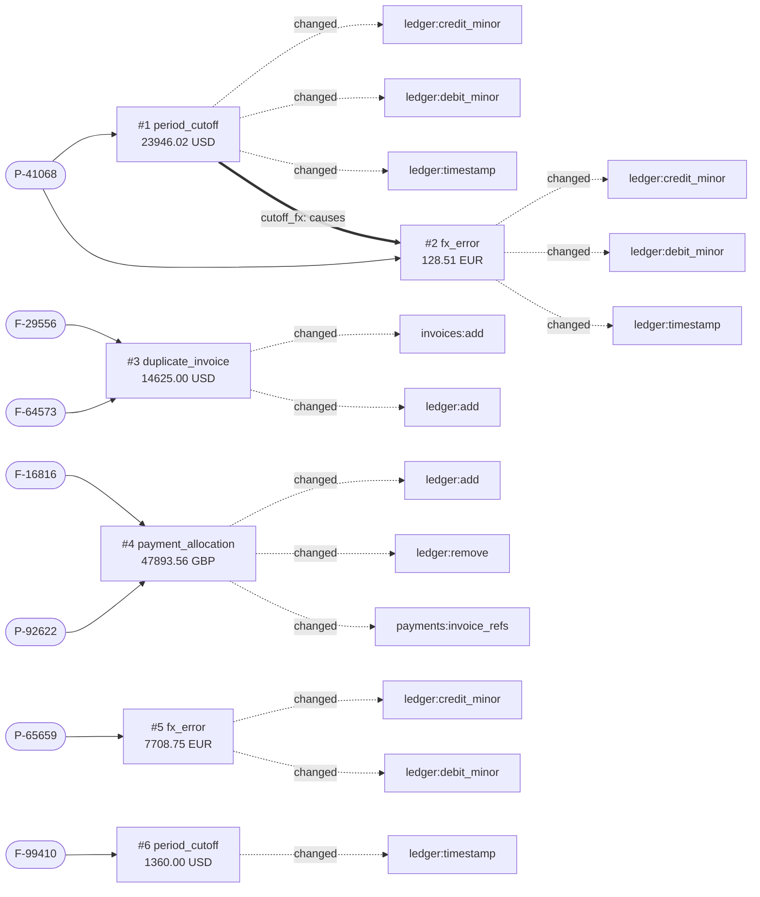

# Episode ep-fdabf5109d2e (evaluator-only)

Period 2026-07-01T00:00:00-07:00 .. 2026-08-01T00:00:00-07:00 (end exclusive), company timezone UTC-07:00, base USD, currencies USD, GBP, EUR. Records: {'ledger_rows': 304, 'invoices': 84, 'payments': 52, 'documents': 136, 'fx_rates': 528}.

## 6 hidden errors

| # | type | affected | amount | how to see it |
|---|---|---|---|---|
| 1 | period_cutoff | P-41068 | 23946.02 USD | Compare the period side (before / in / after, company timezone) of the document timestamp and of its ledger rows. |
| 2 | fx_error (rate of the (wrong) posting date) | P-41068 | 128.51 EUR | Re-convert the ALLOCATED amount at the fx row of the payment's LOCAL date (company timezone) and compare with the AR credit. |
| 3 | duplicate_invoice | F-29556, F-64573 | 14625.00 USD | Same entity, same po_ref, same line items (in a different order) under a second invoice number. |
| 4 | payment_allocation (missing allocation) | F-16816, P-92622 | 47893.56 GBP | The payment memo names an invoice, but invoice_refs allocate less than the amount (or are null); the rest sits in UNAPPLIED. |
| 5 | fx_error (two digits of the rate swapped when keyed in) | P-65659 | 7708.75 EUR | Re-convert the ALLOCATED amount at the fx row of the payment's LOCAL date (company timezone) and compare with the AR credit. |
| 6 | period_cutoff | F-99410 | 1360.00 USD | Compare the period side (before / in / after, company timezone) of the document timestamp and of its ledger rows. |

## Causal graph

## Interacting errors

- **cutoff_fx**: misposted entry converted at the rate of its (wrong) posting date.

## Legitimate look-alikes in this company (not errors)

- same amounts for the same customer with a different po_ref (legitimate repeat orders)
- monthly subscriptions with identical lines
- instalments and multi-invoice payments
- refunds (negative amounts)
- advance payments on account: legitimate UNAPPLIED cash, memo names no invoice
- documents near the period boundary rendered in a foreign UTC offset (calendar-date strings mislead)
- correct cross-currency receipts
