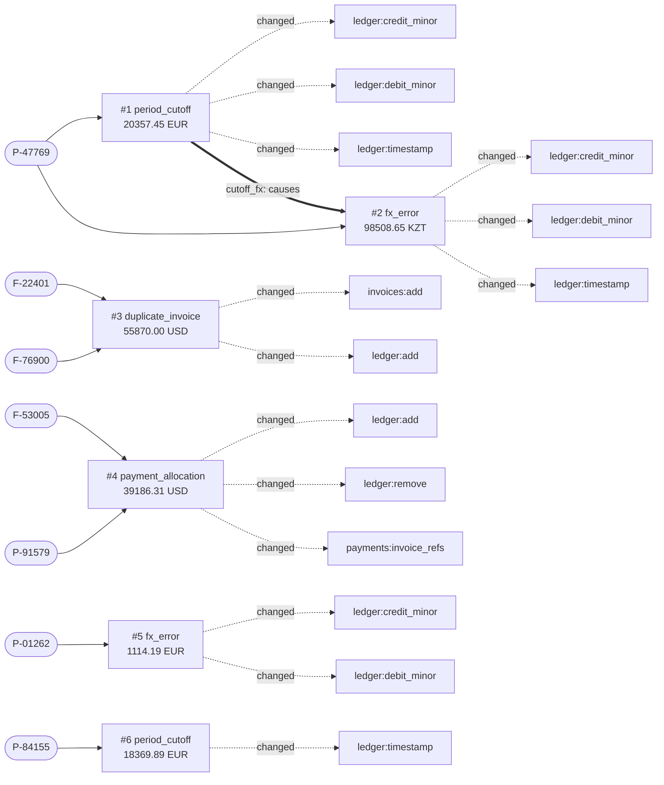

# Episode ep-17dce96f44fb (evaluator-only)

Period 2026-09-01T00:00:00+01:00 .. 2026-10-01T00:00:00+01:00 (end exclusive), company timezone UTC+01:00, base KZT, currencies KZT, EUR, USD. Records: {'ledger_rows': 310, 'invoices': 84, 'payments': 54, 'documents': 138, 'fx_rates': 522}.

## 6 hidden errors

| # | type | affected | amount | how to see it |
|---|---|---|---|---|
| 1 | period_cutoff | P-47769 | 20357.45 EUR | Compare the period side (before / in / after, company timezone) of the document timestamp and of its ledger rows. |
| 2 | fx_error (rate of the (wrong) posting date) | P-47769 | 98508.65 KZT | Re-convert the ALLOCATED amount at the fx row of the payment's LOCAL date (company timezone) and compare with the AR credit. |
| 3 | duplicate_invoice | F-22401, F-76900 | 55870.00 USD | Same entity, same po_ref, same line items (in a different order) under a second invoice number. |
| 4 | payment_allocation (missing allocation) | F-53005, P-91579 | 39186.31 USD | The payment memo names an invoice, but invoice_refs allocate less than the amount (or are null); the rest sits in UNAPPLIED. |
| 5 | fx_error (rate of the invoice date) | P-01262 | 1114.19 EUR | Re-convert the ALLOCATED amount at the fx row of the payment's LOCAL date (company timezone) and compare with the AR credit. |
| 6 | period_cutoff | P-84155 | 18369.89 EUR | Compare the period side (before / in / after, company timezone) of the document timestamp and of its ledger rows. |

## Causal graph

## Interacting errors

- **cutoff_fx**: misposted entry converted at the rate of its (wrong) posting date.

## Legitimate look-alikes in this company (not errors)

- same amounts for the same customer with a different po_ref (legitimate repeat orders)
- monthly subscriptions with identical lines
- instalments and multi-invoice payments
- refunds (negative amounts)
- advance payments on account: legitimate UNAPPLIED cash, memo names no invoice
- documents near the period boundary rendered in a foreign UTC offset (calendar-date strings mislead)
- correct cross-currency receipts
