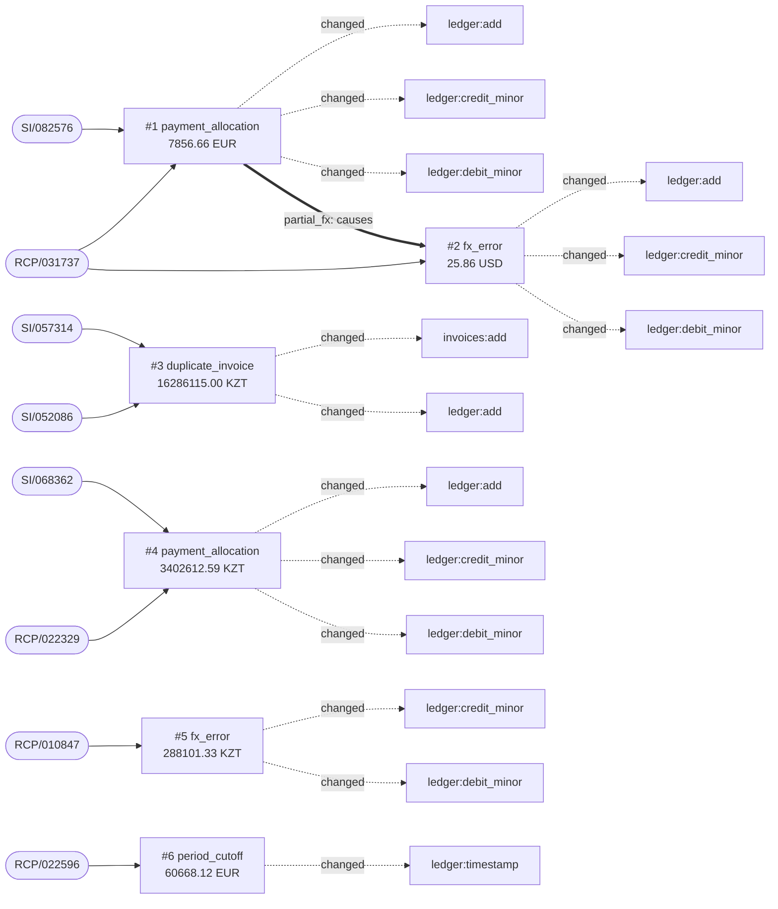

# Episode ep-1f03670ab142 (evaluator-only)

Period 2026-07-01T00:00:00+09:00 .. 2026-10-01T00:00:00+09:00 (end exclusive), company timezone UTC+09:00, base EUR, currencies EUR, KZT, USD. Records: {'ledger_rows': 318, 'invoices': 84, 'payments': 52, 'documents': 136, 'fx_rates': 894}.

## 6 hidden errors

| # | type | affected | amount | how to see it |
|---|---|---|---|---|
| 1 | payment_allocation (partial allocation) | RCP/031737, SI/082576 | 7856.66 EUR | The payment memo names an invoice, but invoice_refs allocate less than the amount (or are null); the rest sits in UNAPPLIED. |
| 2 | fx_error (rate taken for the UTC date instead of the local date) | RCP/031737 | 25.86 USD | Re-convert the ALLOCATED amount at the fx row of the payment's LOCAL date (company timezone) and compare with the AR credit. |
| 3 | duplicate_invoice | SI/052086, SI/057314 | 16286115.00 KZT | Same entity, same po_ref, same line items (in a different order) under a second invoice number. |
| 4 | payment_allocation (partial allocation) | RCP/022329, SI/068362 | 3402612.59 KZT | The payment memo names an invoice, but invoice_refs allocate less than the amount (or are null); the rest sits in UNAPPLIED. |
| 5 | fx_error (rate taken for the UTC date instead of the local date) | RCP/010847 | 288101.33 KZT | Re-convert the ALLOCATED amount at the fx row of the payment's LOCAL date (company timezone) and compare with the AR credit. |
| 6 | period_cutoff | RCP/022596 | 60668.12 EUR | Compare the period side (before / in / after, company timezone) of the document timestamp and of its ledger rows. |

## Causal graph

## Interacting errors

- **partial_fx**: FX conversion applied to the allocated part; wrong rate date taken from the UTC date of the payment.

## Legitimate look-alikes in this company (not errors)

- same amounts for the same customer with a different po_ref (legitimate repeat orders)
- monthly subscriptions with identical lines
- instalments and multi-invoice payments
- refunds (negative amounts)
- advance payments on account: legitimate UNAPPLIED cash, memo names no invoice
- documents near the period boundary rendered in a foreign UTC offset (calendar-date strings mislead)
- correct cross-currency receipts
