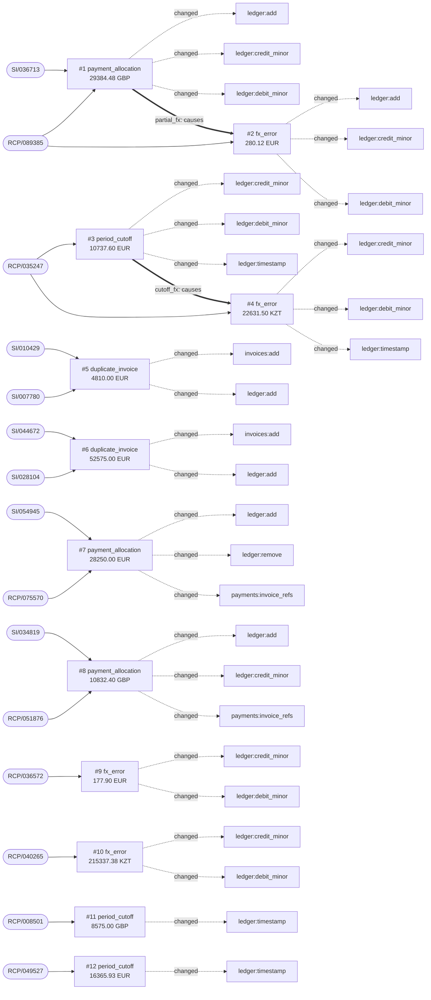

# Episode ep-2f0fd5651b7c (evaluator-only)

Period 2026-05-01T00:00:00+01:00 .. 2026-06-01T00:00:00+01:00 (end exclusive), company timezone UTC+01:00, base EUR, currencies EUR, GBP, KZT. Records: {'ledger_rows': 320, 'invoices': 87, 'payments': 53, 'documents': 140, 'fx_rates': 528}.

## 12 hidden errors

| # | type | affected | amount | how to see it |
|---|---|---|---|---|
| 1 | payment_allocation (partial allocation) | RCP/089385, SI/036713 | 29384.48 GBP | The payment memo names an invoice, but invoice_refs allocate less than the amount (or are null); the rest sits in UNAPPLIED. |
| 2 | fx_error (rate taken for the UTC date instead of the local date) | RCP/089385 | 280.12 EUR | Re-convert the ALLOCATED amount at the fx row of the payment's LOCAL date (company timezone) and compare with the AR credit. |
| 3 | period_cutoff | RCP/035247 | 10737.60 EUR | Compare the period side (before / in / after, company timezone) of the document timestamp and of its ledger rows. |
| 4 | fx_error (rate of the (wrong) posting date) | RCP/035247 | 22631.50 KZT | Re-convert the ALLOCATED amount at the fx row of the payment's LOCAL date (company timezone) and compare with the AR credit. |
| 5 | duplicate_invoice | SI/007780, SI/010429 | 4810.00 EUR | Same entity, same po_ref, same line items (in a different order) under a second invoice number. |
| 6 | duplicate_invoice | SI/028104, SI/044672 | 52575.00 EUR | Same entity, same po_ref, same line items (in a different order) under a second invoice number. |
| 7 | payment_allocation (missing allocation) | RCP/075570, SI/054945 | 28250.00 EUR | The payment memo names an invoice, but invoice_refs allocate less than the amount (or are null); the rest sits in UNAPPLIED. |
| 8 | payment_allocation (partial allocation) | RCP/051876, SI/034819 | 10832.40 GBP | The payment memo names an invoice, but invoice_refs allocate less than the amount (or are null); the rest sits in UNAPPLIED. |
| 9 | fx_error (rate of the previous day) | RCP/036572 | 177.90 EUR | Re-convert the ALLOCATED amount at the fx row of the payment's LOCAL date (company timezone) and compare with the AR credit. |
| 10 | fx_error (rate of the invoice date) | RCP/040265 | 215337.38 KZT | Re-convert the ALLOCATED amount at the fx row of the payment's LOCAL date (company timezone) and compare with the AR credit. |
| 11 | period_cutoff | RCP/008501 | 8575.00 GBP | Compare the period side (before / in / after, company timezone) of the document timestamp and of its ledger rows. |
| 12 | period_cutoff | RCP/049527 | 16365.93 EUR | Compare the period side (before / in / after, company timezone) of the document timestamp and of its ledger rows. |

## Causal graph

## Interacting errors

- **partial_fx**: FX conversion applied to the allocated part; wrong rate date taken from the UTC date of the payment.
- **cutoff_fx**: misposted entry converted at the rate of its (wrong) posting date.

## Legitimate look-alikes in this company (not errors)

- same amounts for the same customer with a different po_ref (legitimate repeat orders)
- monthly subscriptions with identical lines
- instalments and multi-invoice payments
- refunds (negative amounts)
- advance payments on account: legitimate UNAPPLIED cash, memo names no invoice
- documents near the period boundary rendered in a foreign UTC offset (calendar-date strings mislead)
- correct cross-currency receipts
