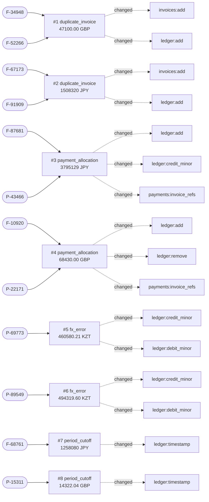

# Episode ep-310c5b5d46ce (evaluator-only)

Period 2026-06-01T00:00:00+02:00 .. 2026-09-01T00:00:00+02:00 (end exclusive), company timezone UTC+02:00, base JPY, currencies JPY, KZT, GBP. Records: {'ledger_rows': 325, 'invoices': 87, 'payments': 59, 'documents': 146, 'fx_rates': 894}.

## 8 hidden errors

| # | type | affected | amount | how to see it |
|---|---|---|---|---|
| 1 | duplicate_invoice | F-34948, F-52266 | 47100.00 GBP | Same entity, same po_ref, same line items (in a different order) under a second invoice number. |
| 2 | duplicate_invoice | F-67173, F-91909 | 1508320 JPY | Same entity, same po_ref, same line items (in a different order) under a second invoice number. |
| 3 | payment_allocation (partial allocation) | F-87681, P-43466 | 3795129 JPY | The payment memo names an invoice, but invoice_refs allocate less than the amount (or are null); the rest sits in UNAPPLIED. |
| 4 | payment_allocation (missing allocation) | F-10920, P-22171 | 68430.00 GBP | The payment memo names an invoice, but invoice_refs allocate less than the amount (or are null); the rest sits in UNAPPLIED. |
| 5 | fx_error (rate of the previous day) | P-69773 | 460580.21 KZT | Re-convert the ALLOCATED amount at the fx row of the payment's LOCAL date (company timezone) and compare with the AR credit. |
| 6 | fx_error (two digits of the rate swapped when keyed in) | P-89549 | 494319.60 KZT | Re-convert the ALLOCATED amount at the fx row of the payment's LOCAL date (company timezone) and compare with the AR credit. |
| 7 | period_cutoff | F-68761 | 1258080 JPY | Compare the period side (before / in / after, company timezone) of the document timestamp and of its ledger rows. |
| 8 | period_cutoff | P-15311 | 14322.04 GBP | Compare the period side (before / in / after, company timezone) of the document timestamp and of its ledger rows. |

## Causal graph

## Legitimate look-alikes in this company (not errors)

- same amounts for the same customer with a different po_ref (legitimate repeat orders)
- monthly subscriptions with identical lines
- instalments and multi-invoice payments
- refunds (negative amounts)
- advance payments on account: legitimate UNAPPLIED cash, memo names no invoice
- documents near the period boundary rendered in a foreign UTC offset (calendar-date strings mislead)
- correct cross-currency receipts
