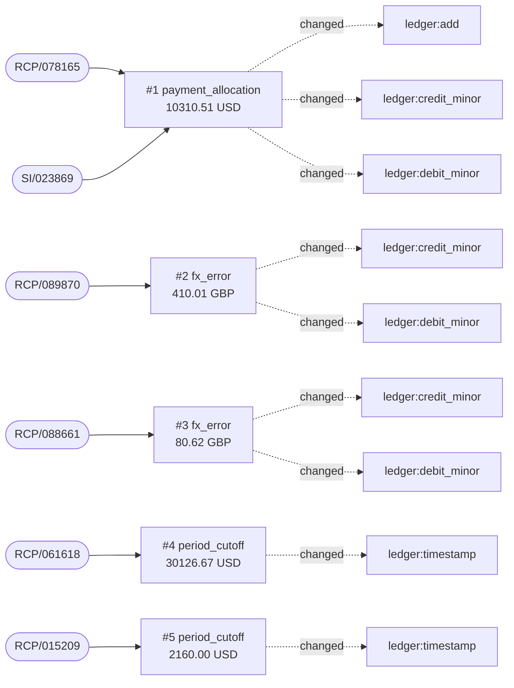

# Episode ep-37f3eb777058 (evaluator-only)

Period 2026-05-01T00:00:00+09:00 .. 2026-07-01T00:00:00+09:00 (end exclusive), company timezone UTC+09:00, base USD, currencies USD, KZT, GBP. Records: {'ledger_rows': 321, 'invoices': 85, 'payments': 53, 'documents': 138, 'fx_rates': 708}.

## 5 hidden errors

| # | type | affected | amount | how to see it |
|---|---|---|---|---|
| 1 | payment_allocation (partial allocation) | RCP/078165, SI/023869 | 10310.51 USD | The payment memo names an invoice, but invoice_refs allocate less than the amount (or are null); the rest sits in UNAPPLIED. |
| 2 | fx_error (two digits of the rate swapped when keyed in) | RCP/089870 | 410.01 GBP | Re-convert the ALLOCATED amount at the fx row of the payment's LOCAL date (company timezone) and compare with the AR credit. |
| 3 | fx_error (rate of the previous day) | RCP/088661 | 80.62 GBP | Re-convert the ALLOCATED amount at the fx row of the payment's LOCAL date (company timezone) and compare with the AR credit. |
| 4 | period_cutoff | RCP/061618 | 30126.67 USD | Compare the period side (before / in / after, company timezone) of the document timestamp and of its ledger rows. |
| 5 | period_cutoff | RCP/015209 | 2160.00 USD | Compare the period side (before / in / after, company timezone) of the document timestamp and of its ledger rows. |

## Causal graph

## Legitimate look-alikes in this company (not errors)

- same amounts for the same customer with a different po_ref (legitimate repeat orders)
- monthly subscriptions with identical lines
- instalments and multi-invoice payments
- refunds (negative amounts)
- advance payments on account: legitimate UNAPPLIED cash, memo names no invoice
- documents near the period boundary rendered in a foreign UTC offset (calendar-date strings mislead)
- correct cross-currency receipts
