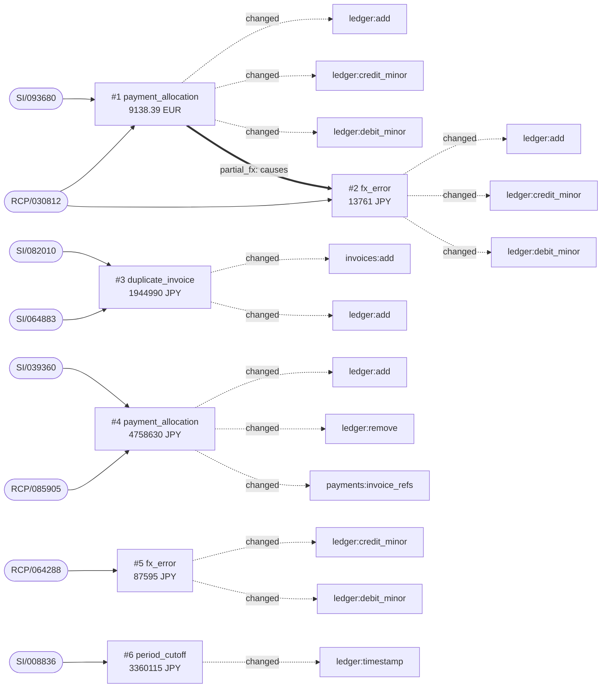

# Episode ep-3e4a4edb987e (evaluator-only)

Period 2026-01-01T00:00:00+00:00 .. 2026-04-01T00:00:00+00:00 (end exclusive), company timezone UTC+00:00, base JPY, currencies JPY, KZT, EUR. Records: {'ledger_rows': 353, 'invoices': 86, 'payments': 64, 'documents': 150, 'fx_rates': 882}.

## 6 hidden errors

| # | type | affected | amount | how to see it |
|---|---|---|---|---|
| 1 | payment_allocation (partial allocation) | RCP/030812, SI/093680 | 9138.39 EUR | The payment memo names an invoice, but invoice_refs allocate less than the amount (or are null); the rest sits in UNAPPLIED. |
| 2 | fx_error (rate of the previous day) | RCP/030812 | 13761 JPY | Re-convert the ALLOCATED amount at the fx row of the payment's LOCAL date (company timezone) and compare with the AR credit. |
| 3 | duplicate_invoice | SI/064883, SI/082010 | 1944990 JPY | Same entity, same po_ref, same line items (in a different order) under a second invoice number. |
| 4 | payment_allocation (missing allocation) | RCP/085905, SI/039360 | 4758630 JPY | The payment memo names an invoice, but invoice_refs allocate less than the amount (or are null); the rest sits in UNAPPLIED. |
| 5 | fx_error (rate of the invoice date) | RCP/064288 | 87595 JPY | Re-convert the ALLOCATED amount at the fx row of the payment's LOCAL date (company timezone) and compare with the AR credit. |
| 6 | period_cutoff | SI/008836 | 3360115 JPY | Compare the period side (before / in / after, company timezone) of the document timestamp and of its ledger rows. |

## Causal graph

## Interacting errors

- **partial_fx**: FX conversion applied to the allocated part; wrong rate date taken from the UTC date of the payment.

## Legitimate look-alikes in this company (not errors)

- same amounts for the same customer with a different po_ref (legitimate repeat orders)
- monthly subscriptions with identical lines
- instalments and multi-invoice payments
- refunds (negative amounts)
- advance payments on account: legitimate UNAPPLIED cash, memo names no invoice
- documents near the period boundary rendered in a foreign UTC offset (calendar-date strings mislead)
- correct cross-currency receipts
