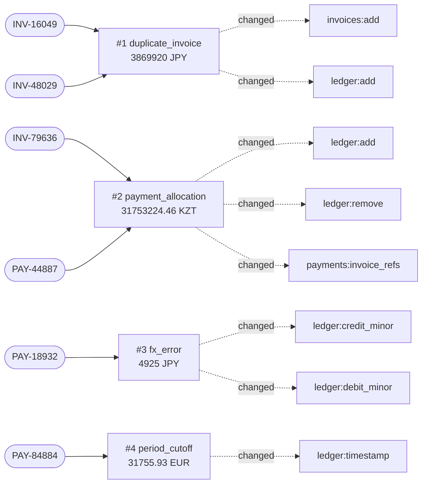

# Episode ep-45490c9e5018 (evaluator-only)

Period 2026-09-01T00:00:00+05:30 .. 2026-12-01T00:00:00+05:30 (end exclusive), company timezone UTC+05:30, base JPY, currencies JPY, KZT, EUR. Records: {'ledger_rows': 314, 'invoices': 82, 'payments': 57, 'documents': 139, 'fx_rates': 888}.

## 4 hidden errors

| # | type | affected | amount | how to see it |
|---|---|---|---|---|
| 1 | duplicate_invoice | INV-16049, INV-48029 | 3869920 JPY | Same entity, same po_ref, same line items (in a different order) under a second invoice number. |
| 2 | payment_allocation (missing allocation) | INV-79636, PAY-44887 | 31753224.46 KZT | The payment memo names an invoice, but invoice_refs allocate less than the amount (or are null); the rest sits in UNAPPLIED. |
| 3 | fx_error (rate of the previous day) | PAY-18932 | 4925 JPY | Re-convert the ALLOCATED amount at the fx row of the payment's LOCAL date (company timezone) and compare with the AR credit. |
| 4 | period_cutoff | PAY-84884 | 31755.93 EUR | Compare the period side (before / in / after, company timezone) of the document timestamp and of its ledger rows. |

## Causal graph

## Legitimate look-alikes in this company (not errors)

- same amounts for the same customer with a different po_ref (legitimate repeat orders)
- monthly subscriptions with identical lines
- instalments and multi-invoice payments
- refunds (negative amounts)
- advance payments on account: legitimate UNAPPLIED cash, memo names no invoice
- documents near the period boundary rendered in a foreign UTC offset (calendar-date strings mislead)
- correct cross-currency receipts
