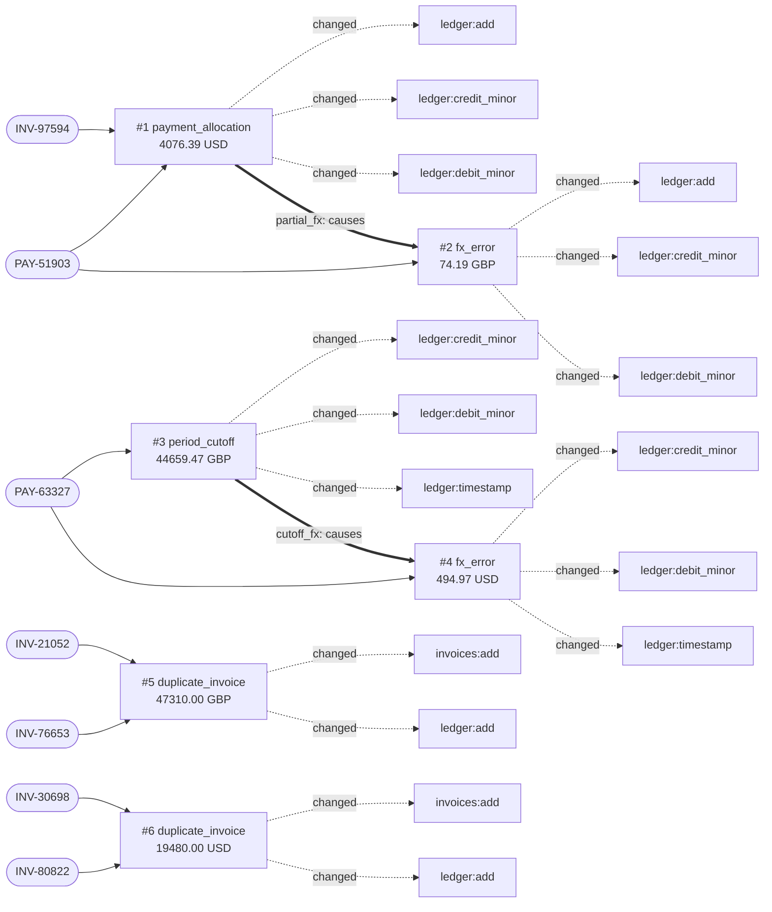

# Episode ep-4b8fe8fdfaba (evaluator-only)

Period 2026-04-01T00:00:00+05:30 .. 2026-05-01T00:00:00+05:30 (end exclusive), company timezone UTC+05:30, base GBP, currencies GBP, USD, EUR. Records: {'ledger_rows': 319, 'invoices': 83, 'payments': 54, 'documents': 137, 'fx_rates': 522}.

## 6 hidden errors

| # | type | affected | amount | how to see it |
|---|---|---|---|---|
| 1 | payment_allocation (partial allocation) | INV-97594, PAY-51903 | 4076.39 USD | The payment memo names an invoice, but invoice_refs allocate less than the amount (or are null); the rest sits in UNAPPLIED. |
| 2 | fx_error (rate taken for the UTC date instead of the local date) | PAY-51903 | 74.19 GBP | Re-convert the ALLOCATED amount at the fx row of the payment's LOCAL date (company timezone) and compare with the AR credit. |
| 3 | period_cutoff | PAY-63327 | 44659.47 GBP | Compare the period side (before / in / after, company timezone) of the document timestamp and of its ledger rows. |
| 4 | fx_error (rate of the (wrong) posting date) | PAY-63327 | 494.97 USD | Re-convert the ALLOCATED amount at the fx row of the payment's LOCAL date (company timezone) and compare with the AR credit. |
| 5 | duplicate_invoice | INV-21052, INV-76653 | 47310.00 GBP | Same entity, same po_ref, same line items (in a different order) under a second invoice number. |
| 6 | duplicate_invoice | INV-30698, INV-80822 | 19480.00 USD | Same entity, same po_ref, same line items (in a different order) under a second invoice number. |

## Causal graph

## Interacting errors

- **partial_fx**: FX conversion applied to the allocated part; wrong rate date taken from the UTC date of the payment.
- **cutoff_fx**: misposted entry converted at the rate of its (wrong) posting date.

## Legitimate look-alikes in this company (not errors)

- same amounts for the same customer with a different po_ref (legitimate repeat orders)
- monthly subscriptions with identical lines
- instalments and multi-invoice payments
- refunds (negative amounts)
- advance payments on account: legitimate UNAPPLIED cash, memo names no invoice
- documents near the period boundary rendered in a foreign UTC offset (calendar-date strings mislead)
- correct cross-currency receipts
