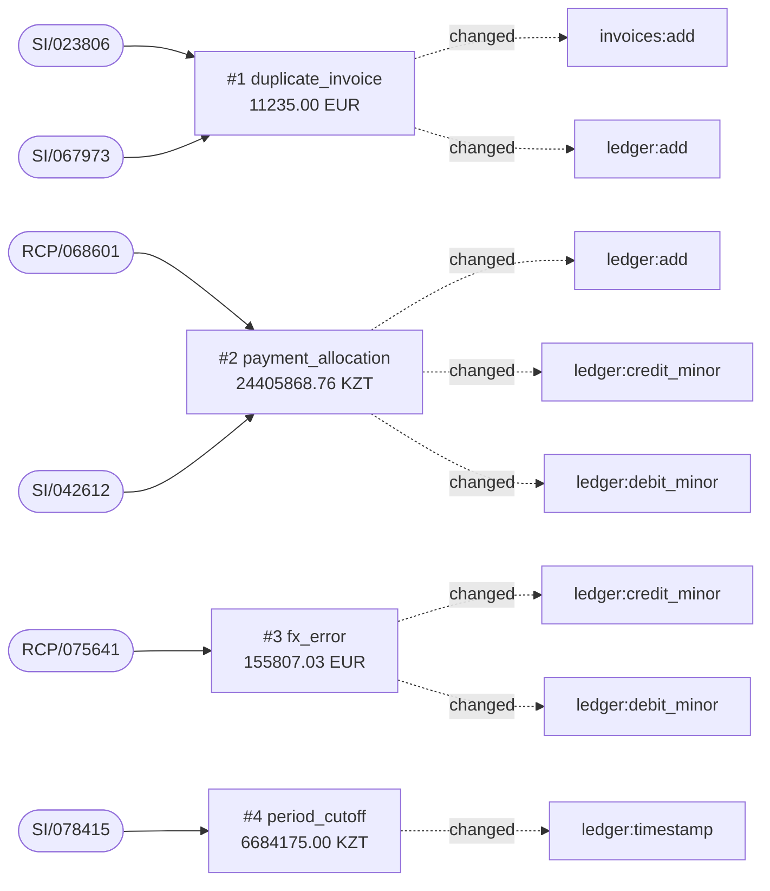

# Episode ep-4c0ddadb177a (evaluator-only)

Period 2026-03-01T00:00:00+02:00 .. 2026-04-01T00:00:00+02:00 (end exclusive), company timezone UTC+02:00, base KZT, currencies KZT, EUR, USD. Records: {'ledger_rows': 297, 'invoices': 82, 'payments': 48, 'documents': 130, 'fx_rates': 528}.

## 4 hidden errors

| # | type | affected | amount | how to see it |
|---|---|---|---|---|
| 1 | duplicate_invoice | SI/023806, SI/067973 | 11235.00 EUR | Same entity, same po_ref, same line items (in a different order) under a second invoice number. |
| 2 | payment_allocation (partial allocation) | RCP/068601, SI/042612 | 24405868.76 KZT | The payment memo names an invoice, but invoice_refs allocate less than the amount (or are null); the rest sits in UNAPPLIED. |
| 3 | fx_error (two digits of the rate swapped when keyed in) | RCP/075641 | 155807.03 EUR | Re-convert the ALLOCATED amount at the fx row of the payment's LOCAL date (company timezone) and compare with the AR credit. |
| 4 | period_cutoff | SI/078415 | 6684175.00 KZT | Compare the period side (before / in / after, company timezone) of the document timestamp and of its ledger rows. |

## Causal graph

## Legitimate look-alikes in this company (not errors)

- same amounts for the same customer with a different po_ref (legitimate repeat orders)
- monthly subscriptions with identical lines
- instalments and multi-invoice payments
- refunds (negative amounts)
- advance payments on account: legitimate UNAPPLIED cash, memo names no invoice
- documents near the period boundary rendered in a foreign UTC offset (calendar-date strings mislead)
- correct cross-currency receipts
