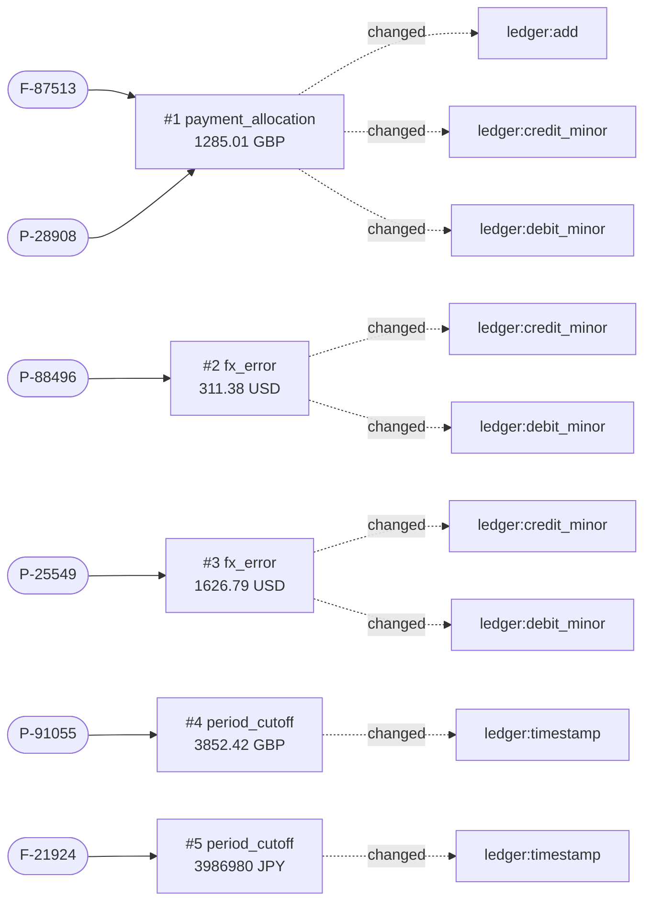

# Episode ep-74f6dabe0a2d (evaluator-only)

Period 2026-01-01T00:00:00+02:00 .. 2026-03-01T00:00:00+02:00 (end exclusive), company timezone UTC+02:00, base JPY, currencies JPY, USD, GBP. Records: {'ledger_rows': 329, 'invoices': 83, 'payments': 59, 'documents': 142, 'fx_rates': 696}.

## 5 hidden errors

| # | type | affected | amount | how to see it |
|---|---|---|---|---|
| 1 | payment_allocation (partial allocation) | F-87513, P-28908 | 1285.01 GBP | The payment memo names an invoice, but invoice_refs allocate less than the amount (or are null); the rest sits in UNAPPLIED. |
| 2 | fx_error (two digits of the rate swapped when keyed in) | P-88496 | 311.38 USD | Re-convert the ALLOCATED amount at the fx row of the payment's LOCAL date (company timezone) and compare with the AR credit. |
| 3 | fx_error (two digits of the rate swapped when keyed in) | P-25549 | 1626.79 USD | Re-convert the ALLOCATED amount at the fx row of the payment's LOCAL date (company timezone) and compare with the AR credit. |
| 4 | period_cutoff | P-91055 | 3852.42 GBP | Compare the period side (before / in / after, company timezone) of the document timestamp and of its ledger rows. |
| 5 | period_cutoff | F-21924 | 3986980 JPY | Compare the period side (before / in / after, company timezone) of the document timestamp and of its ledger rows. |

## Causal graph

## Legitimate look-alikes in this company (not errors)

- same amounts for the same customer with a different po_ref (legitimate repeat orders)
- monthly subscriptions with identical lines
- instalments and multi-invoice payments
- refunds (negative amounts)
- advance payments on account: legitimate UNAPPLIED cash, memo names no invoice
- documents near the period boundary rendered in a foreign UTC offset (calendar-date strings mislead)
- correct cross-currency receipts
