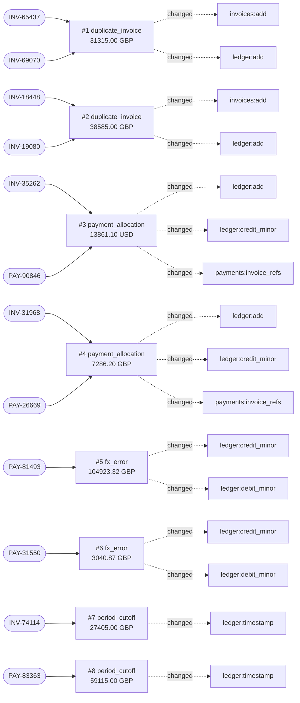

# Episode ep-879e4e329a01 (evaluator-only)

Period 2026-03-01T00:00:00-03:00 .. 2026-05-01T00:00:00-03:00 (end exclusive), company timezone UTC-03:00, base GBP, currencies GBP, KZT, USD. Records: {'ledger_rows': 322, 'invoices': 87, 'payments': 54, 'documents': 141, 'fx_rates': 708}.

## 8 hidden errors

| # | type | affected | amount | how to see it |
|---|---|---|---|---|
| 1 | duplicate_invoice | INV-65437, INV-69070 | 31315.00 GBP | Same entity, same po_ref, same line items (in a different order) under a second invoice number. |
| 2 | duplicate_invoice | INV-18448, INV-19080 | 38585.00 GBP | Same entity, same po_ref, same line items (in a different order) under a second invoice number. |
| 3 | payment_allocation (partial allocation) | INV-35262, PAY-90846 | 13861.10 USD | The payment memo names an invoice, but invoice_refs allocate less than the amount (or are null); the rest sits in UNAPPLIED. |
| 4 | payment_allocation (partial allocation) | INV-31968, PAY-26669 | 7286.20 GBP | The payment memo names an invoice, but invoice_refs allocate less than the amount (or are null); the rest sits in UNAPPLIED. |
| 5 | fx_error (two digits of the rate swapped when keyed in) | PAY-81493 | 104923.32 GBP | Re-convert the ALLOCATED amount at the fx row of the payment's LOCAL date (company timezone) and compare with the AR credit. |
| 6 | fx_error (rate of the invoice date) | PAY-31550 | 3040.87 GBP | Re-convert the ALLOCATED amount at the fx row of the payment's LOCAL date (company timezone) and compare with the AR credit. |
| 7 | period_cutoff | INV-74114 | 27405.00 GBP | Compare the period side (before / in / after, company timezone) of the document timestamp and of its ledger rows. |
| 8 | period_cutoff | PAY-83363 | 59115.00 GBP | Compare the period side (before / in / after, company timezone) of the document timestamp and of its ledger rows. |

## Causal graph

## Legitimate look-alikes in this company (not errors)

- same amounts for the same customer with a different po_ref (legitimate repeat orders)
- monthly subscriptions with identical lines
- instalments and multi-invoice payments
- refunds (negative amounts)
- advance payments on account: legitimate UNAPPLIED cash, memo names no invoice
- documents near the period boundary rendered in a foreign UTC offset (calendar-date strings mislead)
- correct cross-currency receipts
