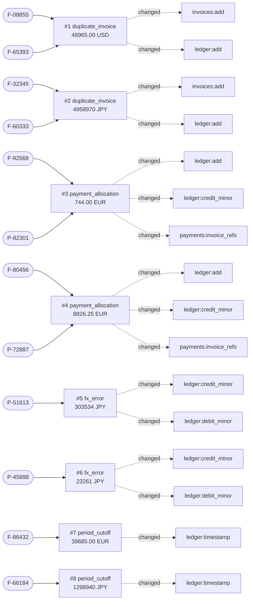

# Episode ep-8a45a0fc10d2 (evaluator-only)

Period 2026-06-01T00:00:00+08:00 .. 2026-08-01T00:00:00+08:00 (end exclusive), company timezone UTC+08:00, base EUR, currencies EUR, USD, JPY. Records: {'ledger_rows': 334, 'invoices': 88, 'payments': 61, 'documents': 149, 'fx_rates': 708}.

## 8 hidden errors

| # | type | affected | amount | how to see it |
|---|---|---|---|---|
| 1 | duplicate_invoice | F-08855, F-65393 | 48965.00 USD | Same entity, same po_ref, same line items (in a different order) under a second invoice number. |
| 2 | duplicate_invoice | F-32345, F-60333 | 4958970 JPY | Same entity, same po_ref, same line items (in a different order) under a second invoice number. |
| 3 | payment_allocation (partial allocation) | F-92568, P-82301 | 744.00 EUR | The payment memo names an invoice, but invoice_refs allocate less than the amount (or are null); the rest sits in UNAPPLIED. |
| 4 | payment_allocation (partial allocation) | F-80456, P-72887 | 8826.25 EUR | The payment memo names an invoice, but invoice_refs allocate less than the amount (or are null); the rest sits in UNAPPLIED. |
| 5 | fx_error (two digits of the rate swapped when keyed in) | P-51613 | 303534 JPY | Re-convert the ALLOCATED amount at the fx row of the payment's LOCAL date (company timezone) and compare with the AR credit. |
| 6 | fx_error (rate of the previous day) | P-45888 | 23261 JPY | Re-convert the ALLOCATED amount at the fx row of the payment's LOCAL date (company timezone) and compare with the AR credit. |
| 7 | period_cutoff | F-86432 | 39685.00 EUR | Compare the period side (before / in / after, company timezone) of the document timestamp and of its ledger rows. |
| 8 | period_cutoff | F-66184 | 1298940 JPY | Compare the period side (before / in / after, company timezone) of the document timestamp and of its ledger rows. |

## Causal graph

## Legitimate look-alikes in this company (not errors)

- same amounts for the same customer with a different po_ref (legitimate repeat orders)
- monthly subscriptions with identical lines
- instalments and multi-invoice payments
- refunds (negative amounts)
- advance payments on account: legitimate UNAPPLIED cash, memo names no invoice
- documents near the period boundary rendered in a foreign UTC offset (calendar-date strings mislead)
- correct cross-currency receipts
