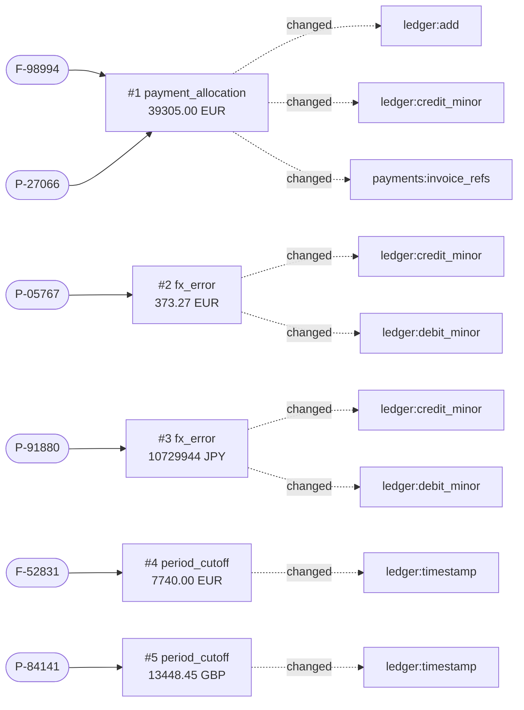

# Episode ep-8d38a1b75293 (evaluator-only)

Period 2026-08-01T00:00:00+08:00 .. 2026-10-01T00:00:00+08:00 (end exclusive), company timezone UTC+08:00, base EUR, currencies EUR, JPY, GBP. Records: {'ledger_rows': 325, 'invoices': 86, 'payments': 57, 'documents': 143, 'fx_rates': 708}.

## 5 hidden errors

| # | type | affected | amount | how to see it |
|---|---|---|---|---|
| 1 | payment_allocation (partial allocation) | F-98994, P-27066 | 39305.00 EUR | The payment memo names an invoice, but invoice_refs allocate less than the amount (or are null); the rest sits in UNAPPLIED. |
| 2 | fx_error (rate of the invoice date) | P-05767 | 373.27 EUR | Re-convert the ALLOCATED amount at the fx row of the payment's LOCAL date (company timezone) and compare with the AR credit. |
| 3 | fx_error (two digits of the rate swapped when keyed in) | P-91880 | 10729944 JPY | Re-convert the ALLOCATED amount at the fx row of the payment's LOCAL date (company timezone) and compare with the AR credit. |
| 4 | period_cutoff | F-52831 | 7740.00 EUR | Compare the period side (before / in / after, company timezone) of the document timestamp and of its ledger rows. |
| 5 | period_cutoff | P-84141 | 13448.45 GBP | Compare the period side (before / in / after, company timezone) of the document timestamp and of its ledger rows. |

## Causal graph

## Legitimate look-alikes in this company (not errors)

- same amounts for the same customer with a different po_ref (legitimate repeat orders)
- monthly subscriptions with identical lines
- instalments and multi-invoice payments
- refunds (negative amounts)
- advance payments on account: legitimate UNAPPLIED cash, memo names no invoice
- documents near the period boundary rendered in a foreign UTC offset (calendar-date strings mislead)
- correct cross-currency receipts
