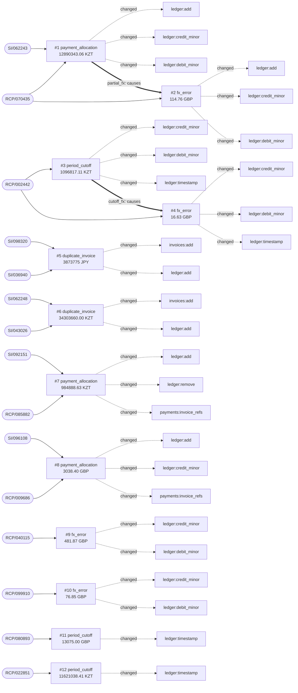

# Episode ep-ad76b7669d46 (evaluator-only)

Period 2026-06-01T00:00:00+05:30 .. 2026-09-01T00:00:00+05:30 (end exclusive), company timezone UTC+05:30, base GBP, currencies GBP, KZT, JPY. Records: {'ledger_rows': 364, 'invoices': 92, 'payments': 65, 'documents': 157, 'fx_rates': 894}.

## 12 hidden errors

| # | type | affected | amount | how to see it |
|---|---|---|---|---|
| 1 | payment_allocation (partial allocation) | RCP/070435, SI/062243 | 12890343.06 KZT | The payment memo names an invoice, but invoice_refs allocate less than the amount (or are null); the rest sits in UNAPPLIED. |
| 2 | fx_error (rate taken for the UTC date instead of the local date) | RCP/070435 | 114.76 GBP | Re-convert the ALLOCATED amount at the fx row of the payment's LOCAL date (company timezone) and compare with the AR credit. |
| 3 | period_cutoff | RCP/002442 | 1096817.11 KZT | Compare the period side (before / in / after, company timezone) of the document timestamp and of its ledger rows. |
| 4 | fx_error (rate of the (wrong) posting date) | RCP/002442 | 16.63 GBP | Re-convert the ALLOCATED amount at the fx row of the payment's LOCAL date (company timezone) and compare with the AR credit. |
| 5 | duplicate_invoice | SI/036940, SI/098320 | 3873775 JPY | Same entity, same po_ref, same line items (in a different order) under a second invoice number. |
| 6 | duplicate_invoice | SI/043026, SI/062248 | 34303660.00 KZT | Same entity, same po_ref, same line items (in a different order) under a second invoice number. |
| 7 | payment_allocation (missing allocation) | RCP/085882, SI/092151 | 984888.63 KZT | The payment memo names an invoice, but invoice_refs allocate less than the amount (or are null); the rest sits in UNAPPLIED. |
| 8 | payment_allocation (partial allocation) | RCP/009686, SI/096108 | 3038.40 GBP | The payment memo names an invoice, but invoice_refs allocate less than the amount (or are null); the rest sits in UNAPPLIED. |
| 9 | fx_error (rate of the previous day) | RCP/040115 | 481.87 GBP | Re-convert the ALLOCATED amount at the fx row of the payment's LOCAL date (company timezone) and compare with the AR credit. |
| 10 | fx_error (rate of the invoice date) | RCP/099910 | 76.85 GBP | Re-convert the ALLOCATED amount at the fx row of the payment's LOCAL date (company timezone) and compare with the AR credit. |
| 11 | period_cutoff | RCP/080893 | 13075.00 GBP | Compare the period side (before / in / after, company timezone) of the document timestamp and of its ledger rows. |
| 12 | period_cutoff | RCP/022851 | 11621038.41 KZT | Compare the period side (before / in / after, company timezone) of the document timestamp and of its ledger rows. |

## Causal graph

## Interacting errors

- **partial_fx**: FX conversion applied to the allocated part; wrong rate date taken from the UTC date of the payment.
- **cutoff_fx**: misposted entry converted at the rate of its (wrong) posting date.

## Legitimate look-alikes in this company (not errors)

- same amounts for the same customer with a different po_ref (legitimate repeat orders)
- monthly subscriptions with identical lines
- instalments and multi-invoice payments
- refunds (negative amounts)
- advance payments on account: legitimate UNAPPLIED cash, memo names no invoice
- documents near the period boundary rendered in a foreign UTC offset (calendar-date strings mislead)
- correct cross-currency receipts
