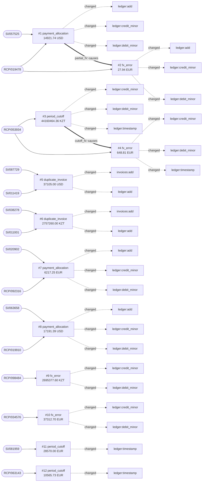

# Episode ep-b9630892e373 (evaluator-only)

Period 2026-01-01T00:00:00+01:00 .. 2026-02-01T00:00:00+01:00 (end exclusive), company timezone UTC+01:00, base USD, currencies USD, EUR, KZT. Records: {'ledger_rows': 339, 'invoices': 89, 'payments': 55, 'documents': 144, 'fx_rates': 528}.

## 12 hidden errors

| # | type | affected | amount | how to see it |
|---|---|---|---|---|
| 1 | payment_allocation (partial allocation) | RCP/019478, SI/057525 | 14921.74 USD | The payment memo names an invoice, but invoice_refs allocate less than the amount (or are null); the rest sits in UNAPPLIED. |
| 2 | fx_error (rate taken for the UTC date instead of the local date) | RCP/019478 | 27.94 EUR | Re-convert the ALLOCATED amount at the fx row of the payment's LOCAL date (company timezone) and compare with the AR credit. |
| 3 | period_cutoff | RCP/053934 | 44160464.36 KZT | Compare the period side (before / in / after, company timezone) of the document timestamp and of its ledger rows. |
| 4 | fx_error (rate of the (wrong) posting date) | RCP/053934 | 648.81 EUR | Re-convert the ALLOCATED amount at the fx row of the payment's LOCAL date (company timezone) and compare with the AR credit. |
| 5 | duplicate_invoice | SI/011419, SI/087729 | 37105.00 USD | Same entity, same po_ref, same line items (in a different order) under a second invoice number. |
| 6 | duplicate_invoice | SI/011001, SI/038278 | 2757260.00 KZT | Same entity, same po_ref, same line items (in a different order) under a second invoice number. |
| 7 | payment_allocation (partial allocation) | RCP/092316, SI/020902 | 6217.25 EUR | The payment memo names an invoice, but invoice_refs allocate less than the amount (or are null); the rest sits in UNAPPLIED. |
| 8 | payment_allocation (partial allocation) | RCP/019910, SI/063658 | 17191.39 USD | The payment memo names an invoice, but invoice_refs allocate less than the amount (or are null); the rest sits in UNAPPLIED. |
| 9 | fx_error (two digits of the rate swapped when keyed in) | RCP/098484 | 2695377.60 KZT | Re-convert the ALLOCATED amount at the fx row of the payment's LOCAL date (company timezone) and compare with the AR credit. |
| 10 | fx_error (two digits of the rate swapped when keyed in) | RCP/034576 | 37312.70 EUR | Re-convert the ALLOCATED amount at the fx row of the payment's LOCAL date (company timezone) and compare with the AR credit. |
| 11 | period_cutoff | SI/081959 | 28570.00 EUR | Compare the period side (before / in / after, company timezone) of the document timestamp and of its ledger rows. |
| 12 | period_cutoff | RCP/063143 | 10565.73 EUR | Compare the period side (before / in / after, company timezone) of the document timestamp and of its ledger rows. |

## Causal graph

## Interacting errors

- **partial_fx**: FX conversion applied to the allocated part; wrong rate date taken from the UTC date of the payment.
- **cutoff_fx**: misposted entry converted at the rate of its (wrong) posting date.

## Legitimate look-alikes in this company (not errors)

- same amounts for the same customer with a different po_ref (legitimate repeat orders)
- monthly subscriptions with identical lines
- instalments and multi-invoice payments
- refunds (negative amounts)
- advance payments on account: legitimate UNAPPLIED cash, memo names no invoice
- documents near the period boundary rendered in a foreign UTC offset (calendar-date strings mislead)
- correct cross-currency receipts
